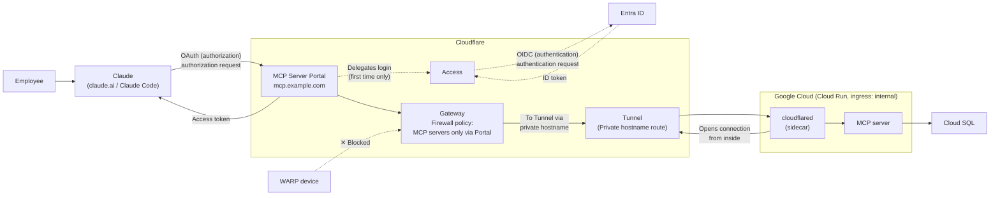
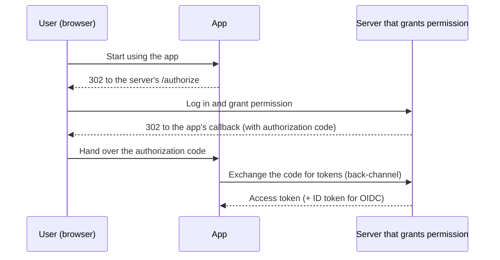
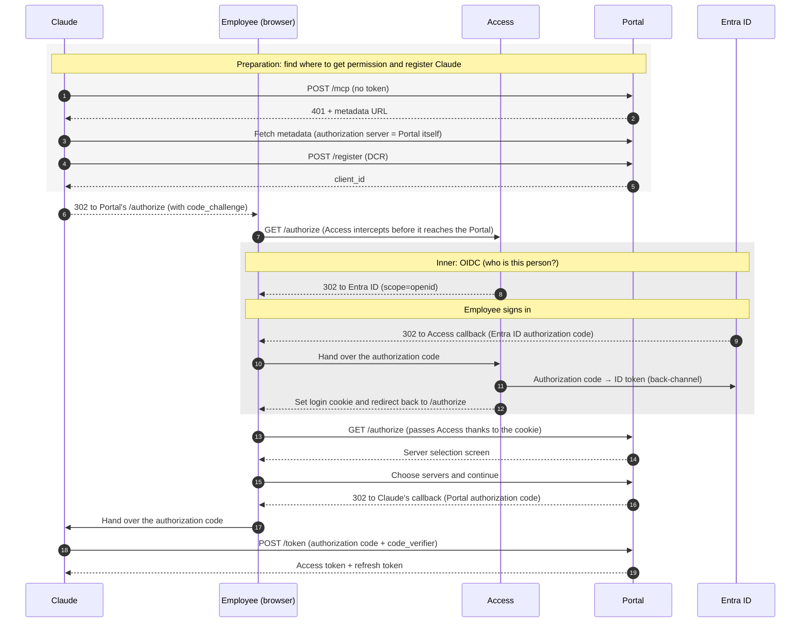
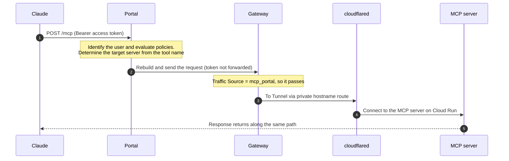
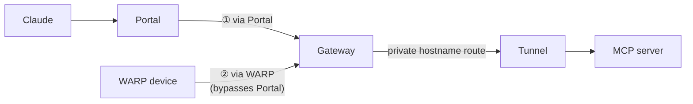

## Overview

We built a platform that lets Claude (claude.ai / Claude Code) connect to our internal MCP servers through a single URL.

The entry point is Cloudflare MCP Server Portal. Login and the decision of "who can use what" are delegated to Cloudflare Access (the access control feature of Zero Trust) and Entra ID. The MCP servers themselves implement no authentication or authorization at all.

The MCP servers run on Cloud Run and are connected through a cloudflared sidecar and Cloudflare Tunnel. There is no entry point from the internet that reaches the MCP servers directly.

However, there was a hole: internal devices running WARP could bypass the Portal and reach the MCP servers directly. We closed it by adding a rule to Gateway's HTTP policies (called Firewall policies in the dashboard) using a condition called Traffic Source, restricting requests to the MCP servers' private hostnames to those coming from the Portal.

This post covers how we arrived at this setup, how the traffic flows, and the pitfalls we hit.

## Background

We were asked to let business-side members (non-engineers) use internal data from Claude as well.

For example, just asking Claude "Check whether we've run a similar campaign for this product before" should search our internal campaign database. That was the goal.

We already have internal APIs, but it isn't realistic for business-side members to use them directly. Each API has a different URL and authentication method, and handing out an API key to every user is risky from a security standpoint.

So we decided to expose the APIs' functionality via MCP (Model Context Protocol). MCP is a standard protocol that lets AI apps like Claude call external tools. If we provide it as an MCP server, users only need to connect once from Claude's connector screen.

## Architecture

### Claude doesn't come from "inside"

The first thing to understand is where Claude connects from.

claude.ai custom connectors connect to MCP servers from Anthropic's cloud, not from the user's PC. The source IPs are published as [`160.79.104.0/21` and `153.61.208.0/20`](https://platform.claude.com/docs/en/api/ip-addresses).

In other words, a defense like "allow access only from the internal network" doesn't work in the first place.

So we designed around the following principle:

> Expose only the entry point (the Portal) to the internet, and authenticate and authorize every request. Put the MCP servers themselves where the internet can't reach them.

### Overall diagram



| Component            | Role                                                                                                                                                                                         |
| -------------------- | -------------------------------------------------------------------------------------------------------------------------------------------------------------------------------------------- |
| MCP Server Portal    | The single entry point for internal MCP. Acts as the OAuth endpoint for Claude, and relays requests while limiting visible servers via each server's Access policy and visible tools via the Portal's tool settings |
| Access               | The access control feature of Cloudflare Zero Trust. Holds an Application (login method and policies) for the Portal and each MCP server, and decides who gets through. Identity verification is delegated to Entra ID |
| Gateway              | Cloudflare's secure web gateway. Traffic from the Portal to private destinations goes through here                                                                                          |
| Tunnel / cloudflared | A path opened from inside Cloud Run toward Cloudflare. No inbound entry point needs to be opened on the Cloud Run side                                                                        |
| MCP server           | Provides the tools                                                                                                                                                                           |

As the diagram shows, authentication and authorization are split into two segments. Between Claude and the Portal it's OAuth (giving Claude an access token); between Access and Entra ID it's OIDC (verifying who the employee is). I'll go into the difference in the "OAuth and OIDC" section.

### What "private" means in this post

There are two main ways to connect a service with Cloudflare Tunnel:

- Published application: create a hostname exposed to the internet and connect it to a Tunnel
- Private hostname route: don't expose anything to the internet; just register a mapping of "this hostname goes to this Tunnel." Only traffic that passes through your own Gateway can use it

We used the latter.

Note that private does **not** mean "reachable only from the Portal." This misunderstanding led to the hole described later.

## Technology choices

### Why Cloudflare MCP Server Portal

Several vendors offer "a gateway that sits in front of multiple MCP servers." I compared them based on their official documentation (as of October 2026).

| Product                          | Fully delegate auth | Reach private upstreams | Per-tool authorization |
| -------------------------------- | ------------------- | ----------------------- | ---------------------- |
| **Cloudflare MCP Server Portal** | ○                   | ○ Tunnel                | △ via logical MCP      |
| AWS Bedrock AgentCore Gateway    | △                   | △ assumes AWS VPC       | ○ Cedar                |
| Azure API Management             | △                   | ○ VNet                  | △                      |
| Kong AI Gateway                  | △                   | ○ self-hosted           | ○                      |

Looking only at fine-grained per-tool authorization, AWS and Kong are stronger. We still chose Cloudflare, mainly for three reasons.

#### Authentication and authorization can be offloaded to Cloudflare

The Portal acts as the OAuth endpoint itself, and login can be delegated to Entra ID via Access.

Authorization is also handled entirely on the Cloudflare side. The Portal and each MCP server each have an Access application (policy settings per protected target), and decisions are made in three layers:

```
Portal application         : Can you enter the Portal? (e.g., employee email domain)
  └ Server application     : Can you see that server? (e.g., Entra ID group)
      └ Portal tool settings: Which tools can you call?
```

By registering the same MCP server twice in the Portal — what we call a "logical MCP" — you can even vary the available tools per group.

```
mcp-a : only read_xxx enabled             / allowed: viewer group
mcp-b : read_xxx and write_xxx enabled    / allowed: editor group
```

Also, users register only one URL: the Portal's. Even as MCP servers are added, nothing changes on the user side.

#### Tunnel cuts off direct paths to the MCP servers

The Portal reaches Tunnel private hostnames via Gateway (a feature added in September 2026; see the [changelog](https://developers.cloudflare.com/changelog/post/2026-09-22-private-mcp-servers/)).

This means we don't need any internet-facing entry point for the MCP servers. As long as cloudflared can run there, the MCP servers can live in any cloud.

#### (Our circumstances) Zero Trust was already in place

We were already using Cloudflare Zero Trust (WARP, Gateway, Access) internally, with Entra ID integration done.

On top of that, there was growing momentum to use Cloudflare as our CDN going forward. Being able to start without adding new infrastructure or contracts helped a lot.

### Why Cloud Run instead of Workers

Initially, the plan was to put the MCP server on Cloudflare Workers as a "thin wrapper" that just calls the existing APIs over HTTP.

However, wrapping the APIs adds one more network hop. That means more latency and more points of failure, and the MCP server would also need credentials to call the APIs. Some tools wait for LLM responses, and a single call can take tens of seconds, so we wanted to avoid adding anything on top.

So instead of wrapping the APIs, we changed course to have the MCP server call the API code (the service layer) directly.

That, in turn, means the MCP server needs to reach databases like Cloud SQL and LLMs from inside Google Cloud. Reaching Google Cloud internals from Workers is hard (Workers VPC was in beta), and we'd have to rewrite the code in TypeScript.

With Cloud Run, it runs on the same network and the same container image as the existing APIs. In fact, the MCP server uses the same image as the API, with only the startup command swapped.

```yaml
containers:
  - name: mcp-server
    image: ${DEPLOY_IMAGE} # same image as the API
    command:
      ["uvicorn", "mcp_server.main:app", "--host", "0.0.0.0", "--port", "80"]
```

### Why connect via Tunnel

We compared the following four options for the path from the Portal to Cloud Run.

| Option              | Robustness                                                                         | Verdict |
| ------------------- | ---------------------------------------------------------------------------------- | ------- |
| **Tunnel (chosen)** | High. The MCP server has no internet-facing entry point                            | ○       |
| LB + Cloud Armor    | Medium. Restricting by Gateway egress IP can't narrow it down to just the Portal   | △       |
| Relay via Worker    | High. But the Worker must hold a Google Cloud service account key                  | △       |
| Shared secret       | Low. If the header value leaks, it's bypassed                                      | ×       |

The LB option can't be narrowed down to just the Portal because Gateway's egress IPs are shared with other Cloudflare customers by default, and even with dedicated IPs (Dedicated egress IP), they're shared with traffic from WARP devices.

cloudflared runs as a Cloud Run sidecar.

```yaml
metadata:
  annotations:
    run.googleapis.com/ingress: internal # unreachable from the internet
spec:
  template:
    metadata:
      annotations:
        run.googleapis.com/vpc-access-egress: all-traffic
        run.googleapis.com/cpu-throttling: "false" # always allocate CPU to keep the Tunnel up
        autoscaling.knative.dev/minScale: "1"
    spec:
      containers:
        - name: mcp-server
          # ...
        - name: cloudflared
          image: cloudflare/cloudflared:2026.10.0
          args: ["tunnel", "--no-autoupdate", "run"]
          env:
            - name: TUNNEL_TOKEN
              valueFrom:
                secretKeyRef: { name: MCP_TUNNEL_TOKEN, key: latest }
```

To be honest, the Tunnel option costs more than the LB option.

Always-allocated CPU switches the whole instance to instance-based billing (billed for the entire time it's running). Running for 30 days in the Tokyo region, the fixed cost was about $20–39 for the LB option versus about $76 for the Tunnel option. Most of the difference comes from the change in billing model, not from the sidecar itself.

We still chose Tunnel because we prioritized "not creating any entry point that reaches the MCP server from outside."

## Traffic flow

### OAuth and OIDC

Before following the traffic, let's sort out OAuth and OIDC. They're often confused, but they play different roles.

- **OAuth 2.0**: a mechanism for granting an app permission to "use resources on the user's behalf" (authorization). An access token is issued
- **OIDC (OpenID Connect)**: an extension of OAuth 2.0 that lets you verify "who this user is" (authentication). An ID token is issued in addition to the access token

An ID token is a "digital ID card" issued by the OIDC provider. It's a signed JWT, and when decoded it contains information like this (values are examples):

```jsonc
{
  "iss": "https://sts.windows.net/<tenant ID>/", // who issued it
  "aud": "<recipient's client_id>", // who it's for
  "exp": 1793408400, // expiration
  "name": "Taro Yamada", // who the user is
}
```

The recipient verifies the signature with the issuer's public key and checks `iss`, `aud`, and `exp` before trusting the contents. While an access token is "a key you show to an API," an ID token is "an ID card read by the recipient itself."

In this setup, the two are nested. Before the Portal gives Claude an access token (OAuth), it needs to verify who the employee is with Entra ID (OIDC).

```
OAuth: Claude ◀──▶ Portal       "Grant Claude permission to use the Portal on this employee's behalf"
  └ OIDC: Access ◀──▶ Entra ID  Verify "who this person is"
```

### First connection (authentication)

The employee only does three things: click connect on the connector, sign in with Entra ID, and choose which servers to use. Let's walk through what happens behind the scenes, starting from the foundation.

#### Foundation: the authorization code flow

Both OAuth and OIDC here use the "authorization code flow." The OAuth spec calls it the Authorization Code Grant and the OIDC spec calls it the Authorization Code Flow, but the exchange has the same shape. OIDC just adds two things to it: "include `openid` in `scope`" and "an ID token is returned."



Two key points:

- The app never touches the user's password. The server shows the login screen and talks to the app via browser redirects
- Tokens don't pass through the browser. Only a short-lived "authorization code (claim ticket)" goes through the browser, and the exchange for tokens happens directly between the app and the server

#### Mapping the roles

Mapping the OAuth and OIDC roles onto our setup looks like this (alongside the examples from [this article](https://zenn.dev/newbee1939/articles/about-oauth-oidc), in Japanese).

**OAuth (outer)**

| Role                 | Typical example                | This setup       |
| -------------------- | ------------------------------ | ---------------- |
| Resource Owner       | Owner of the Google Drive      | Employee         |
| Client               | App that wants to use Drive    | Claude           |
| Authorization Server | Google's authorization server  | Portal           |
| Resource Server      | Google Drive API               | Portal (`/mcp`)  |

**OIDC (inner)**

| Role            | Typical example (log in to Vercel with GitHub) | This setup |
| --------------- | ---------------------------------------------- | ---------- |
| End User        | Person using Vercel                            | Employee   |
| Relying Party   | Vercel                                         | Access     |
| OpenID Provider | GitHub                                         | Entra ID   |

On the OAuth side, the Portal both issues tokens (Authorization Server) and accepts them (Resource Server). They can be separate servers like Google's, but they can also be the same.

However, the Portal doesn't verify identity itself. That's handled on the OIDC side, where Access takes the position of "trusting Entra ID when it says this is the person" (Relying Party = the side that relies).

#### The whole flow

Putting the two together gives the following. The entire OIDC flow slots into the "log in" step of the OAuth flow.



**Preparation (1–5)**: All Claude knows at first is `https://mcp.example.com/mcp`, entered on the connector screen. Calling it without a token returns 401, and the `WWW-Authenticate` header points to the metadata location (RFC 9728). The metadata's `authorization_servers` points to the Portal itself, so Claude learns "get the token from the Portal." It then registers itself on the spot via DCR (RFC 7591) and receives a `client_id`. Since you can't know in advance which AI app a user will use, MCP uses this approach instead of pre-registration (the latest spec recommends CIMD and treats DCR as deprecated, but the Portal doesn't support CIMD yet).

**Inner OIDC (8–12)**: Access sends the employee to Entra ID, exchanges the returned authorization code for an ID token on the back-channel, and learns "who they are and which groups they belong to." It then issues its own login cookie and redirects back to `/authorize`. From the Portal's point of view, only employees whose identity has been verified ever reach `/authorize`, so the Portal itself never needs to know passwords or Entra ID.

**Outer OAuth (6–7, 13–19)**: The Portal identifies the employee from the cookie and lists only the servers that person can see on the selection screen. When the employee continues, the Portal returns an authorization code to Claude, and Claude exchanges it for an access token.

**PKCE (6 and 18)**: A mechanism that prevents a stolen authorization code from being exchanged for an access token (RFC 7636). Claude generates two values for each connection:

- `code_verifier`: a random string. Claude keeps it hidden
- `code_challenge`: the SHA-256 hash of `code_verifier`. Fine if someone sees it

```text
6  Attach code_challenge to /authorize → Portal remembers it alongside the authorization code
18 Attach code_verifier to /token      → Portal hashes it and issues tokens if it matches code_challenge
```

The authorization code passes through the browser, so it could be stolen, but `code_verifier` never passes through the browser, so it can't be. And since you can't reverse a hash back to the original value, a stolen authorization code alone can't be exchanged for an access token.

The outer and inner flows have the same shape. The only difference is who's asking whom.

|                        | Outer (OAuth)               | Inner (OIDC)                                  |
| ---------------------- | --------------------------- | --------------------------------------------- |
| Requester              | Claude                      | Access                                        |
| Requested              | Portal                      | Entra ID                                      |
| Origin of `client_id`  | Registered on the spot (DCR) | Pre-registered in Entra ID by an admin        |
| What you finally get   | Access token                | ID token                                      |

### Tool calls

After authentication, when Claude calls a tool once, the request takes the following path.



The Portal merges tools from multiple servers into a single list for Claude. To avoid name collisions, it prefixes tool names with `{server ID}_`, and on each call it determines the target server from the first `_`. Changing a server ID later also changes the tool names, so pick names you don't intend to change.

The Portal doesn't forward the access token received from Claude upstream. The MCP spec forbids passing tokens straight through to upstream (token passthrough). In our case, the upstream MCP servers are registered as "no authentication," so the Portal sends requests without any credentials.

The Tunnel is a connection opened from cloudflared toward Cloudflare. Requests from Gateway travel back along this outbound connection to reach cloudflared.

The connection from cloudflared to Cloud Run comes from the VPC, so it passes the `ingress: internal` restriction. cloudflared doesn't attach a Google ID token, so the Cloud Run Invoker is set to `allUsers`. `allUsers` may sound dangerous, but it's fine because it's unreachable from the internet. Here, protection comes from ingress and Tunnel, not IAM.

## Pitfalls

### WARP devices could bypass the Portal

While verifying the Tunnel setup, I tried sending a request directly to the MCP server's private hostname from an internal device running WARP. It reached the MCP server without going through the Portal.

The MCP server has no authentication, so reaching it directly means bypassing everything: the Access policies and the tool disabling in the Portal.

#### Why it gets through

WARP is an app that sends a device's traffic to Cloudflare Gateway. When a WARP device accesses a private hostname, the request reaches Gateway without going through the Portal and is routed straight to the Tunnel (during name resolution, Gateway returns a placeholder IP (`172.64.128.0/20`) and routes traffic to that IP into the Tunnel).



In other words, the two paths converged at Gateway. On top of that, Gateway allows any traffic that doesn't match a policy (implicit Allow).

Tunnel only protects you to the extent of "unreachable from the internet." From Cloudflare's point of view, WARP devices are "inside."

#### Fix: restrict the MCP servers to Portal-only traffic

Gateway has a condition called "Traffic Source" (`net.onramp.type`) that indicates which entry point the traffic came in through. Traffic from WARP devices is `device_client`, and traffic from the Portal is `mcp_portal`.

Using this, we added the following rule to Gateway's HTTP policies (Zero Trust > Traffic controls > Firewall policies in the dashboard):

```
Destination host is the MCP server's private hostname,
and Traffic Source is not "MCP portal" → Block
```

In other words, only requests from the Portal can reach the MCP servers' private hostnames. Everything from other entry points, such as WARP devices, is blocked.

## Summary

- Consolidated the entry point into a single MCP Server Portal and delegated authentication and authorization to Access and Entra ID. The MCP servers implement no authentication
- Connected the MCP servers via Tunnel private hostnames, placing them where the internet can't reach
- However, private doesn't mean "reachable only from the Portal." We needed Gateway's Traffic Source to block requests that don't come through the Portal

## References

- MCP specification (2026-07-28) authorization: https://modelcontextprotocol.io/specification/2026-07-28/basic/authorization
- RFC 6749 (OAuth 2.0) / RFC 7591 (DCR) / RFC 7636 (PKCE) / RFC 8414 (Authorization Server Metadata) / RFC 9728 (Protected Resource Metadata)
- Cloudflare MCP Server Portals: https://developers.cloudflare.com/cloudflare-one/access-controls/ai-controls/mcp-portals/
- Gateway HTTP policies (Traffic Source): https://developers.cloudflare.com/cloudflare-one/traffic-controls/http-policies/
- Tunnel private hostnames: https://developers.cloudflare.com/cloudflare-one/networks/connectors/cloudflare-tunnel/private-net/cloudflared/connect-private-hostname/
