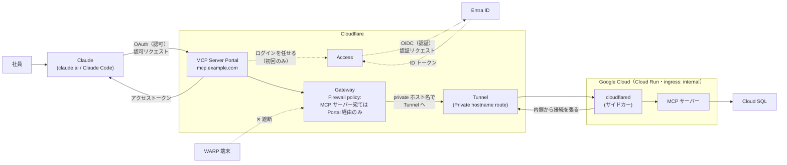
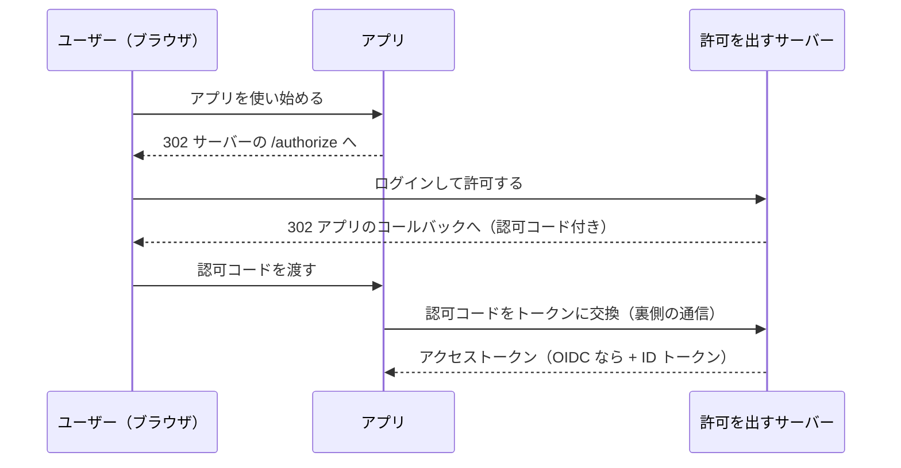
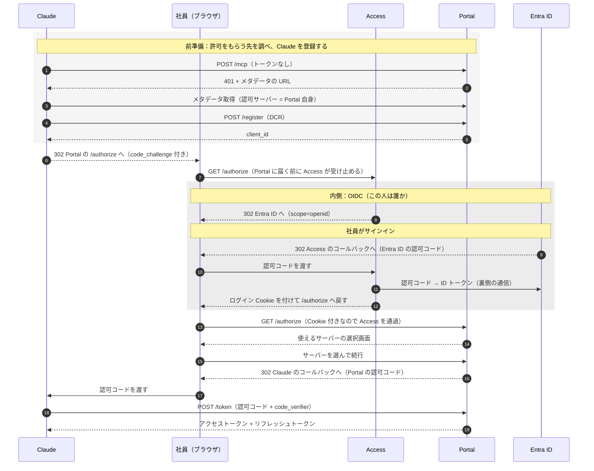
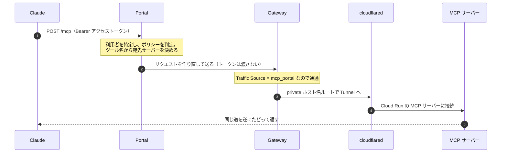
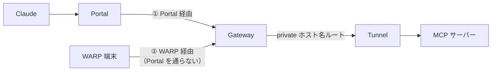

## 概要

Claude（claude.ai / Claude Code）から社内の MCP サーバーに、1 つの URL でつなげる基盤を作りました。

入口には Cloudflare MCP Server Portal を使っています。ログインと「誰に何を使わせるか」の判定は Cloudflare Access（Zero Trust のアクセス制御機能）と Entra ID に任せています。MCP サーバー側には認証・認可の処理を一切実装していません。

MCP サーバー本体は Cloud Run に置き、cloudflared サイドカーと Cloudflare Tunnel でつないでいます。インターネットから MCP サーバーに直接届く入口はありません。

ただ、WARP を入れた社内端末からは Portal を迂回して MCP サーバーに直接届いてしまうという穴がありました。最終的に、Gateway の HTTP ポリシー（管理画面では Firewall policies）に Traffic Source という条件を使ったルールを足し、MCP サーバーの private ホスト名へのリクエストを Portal から来たものだけに制限して塞いでいます。

この記事では、この構成に至った経緯と通信の流れ、ぶつかった壁について書いていきます。

## 背景

ビジネス側のメンバー（非エンジニア）にも、社内のデータを Claude から使ってほしいという依頼がありました。

例えば「この商材で過去に似た施策をやったことがあるか調べて」と Claude に頼むだけで、社内の施策データベースを検索できる。そんな状態を目指しました。

社内には API がすでにありますが、ビジネス側のメンバーが API を直接使うのは現実的ではありません。API ごとに URL や認証方式が違いますし、利用者一人ひとりに API キーを配るのはセキュリティ的にも危ないです。

そこで、API の機能を MCP（Model Context Protocol）で提供することにしました。MCP は、Claude のような AI アプリが外部のツールを呼ぶための標準プロトコルです。MCP サーバーとして提供すれば、利用者は Claude のコネクター画面で一度接続するだけで済みます。

## アーキテクチャ

### Claude は「社内」からは来ない

まず押さえておく必要があるのが、Claude がどこから接続してくるのかです。

claude.ai のカスタムコネクターは、利用者の PC からではなく Anthropic のクラウドから MCP サーバーに接続してきます。接続元の IP は [`160.79.104.0/21` と `153.61.208.0/20`](https://platform.claude.com/docs/en/api/ip-addresses) と公開されています。

つまり、「社内ネットワークからのアクセスだけを許可する」という守り方はそもそも成り立たないということです。

そこで、次の方針で設計することにしました。

> 入口（Portal）だけをインターネットに公開し、リクエストのたびに認証・認可を行う。MCP サーバー本体はインターネットから届かない場所に置く。

### 全体図



| 登場人物             | 役割                                                                                                                                                                 |
| -------------------- | -------------------------------------------------------------------------------------------------------------------------------------------------------------------- |
| MCP Server Portal    | 社内 MCP の唯一の入口。Claude 向けの OAuth の窓口になり、各サーバーの Access ポリシーで見せるサーバーを、Portal のツール設定で見せるツールを絞って中継する           |
| Access               | Cloudflare Zero Trust のアクセス制御機能。Portal と各 MCP サーバーに Application（ログイン方法とポリシー）を持ち、誰を通すかを判定する。本人確認は Entra ID に任せる |
| Gateway              | Cloudflare のセキュア Web ゲートウェイ。Portal から private な宛先への通信はここを通る                                                                               |
| Tunnel / cloudflared | Cloud Run の内側から Cloudflare に向けて張る通り道。Cloud Run 側に外から入る口を開けずに済む                                                                         |
| MCP サーバー         | ツールを提供する                                                                                                                                                     |

図の通り、認証・認可の区間は 2 つに分かれています。Claude と Portal の間は OAuth（Claude にアクセストークンを渡す）、Access と Entra ID の間は OIDC（社員が誰なのかを確かめる）です。この違いは「OAuth と OIDC」の項で詳しく書きます。

### この記事でいう「private」

Cloudflare Tunnel でサービスをつなぐ方法は、大きく 2 つあります。

- Published application：インターネットに公開するホスト名を作り、その先を Tunnel につなぐ
- Private hostname route：インターネットには公開せず、「このホスト名はこの Tunnel へ」という対応表だけを登録する。使えるのは自社の Gateway を通る通信だけ

今回使ったのは後者です。

ここで注意したいのは、private は「Portal からしか届かない」という意味ではないということです。この勘違いが、後で書く穴につながりました。

## 技術選定

### なぜ Cloudflare MCP Server Portal なのか

「複数の MCP サーバーの前に立つゲートウェイ」は各社から出ています。公式ドキュメントの記載をもとに比べてみました（2026 年 10 月時点）。

| 製品                             | 認証を丸ごと任せられる | private な上流に届く | ツール単位の認可  |
| -------------------------------- | ---------------------- | -------------------- | ----------------- |
| **Cloudflare MCP Server Portal** | ○                      | ○ Tunnel             | △ 論理 MCP で対応 |
| AWS Bedrock AgentCore Gateway    | △                      | △ AWS の VPC が前提  | ○ Cedar           |
| Azure API Management             | △                      | ○ VNet               | △                 |
| Kong AI Gateway                  | △                      | ○ セルフホスト       | ○                 |

ツール単位の細かい認可だけを見れば、AWS や Kong のほうが強いです。それでも Cloudflare を選んだのは、主に次の 3 つの理由からです。

#### 認証・認可を Cloudflare に寄せられる

Portal は自身が OAuth の窓口になり、ログインは Access 経由で Entra ID に任せられます。

認可も Cloudflare 側だけで完結します。Portal と各 MCP サーバーにはそれぞれ Access のアプリケーション（守る対象ごとのポリシー設定）が付いていて、判定は次の 3 段で行われます。

```
Portal のアプリケーション     ：Portal に入れるか（例: 社員のメールドメイン）
  └ サーバーのアプリケーション：そのサーバーが見えるか（例: Entra ID のグループ）
      └ Portal のツール設定   ：どのツールを呼べるか
```

同じ MCP サーバーを Portal に 2 件登録する「論理 MCP」という使い方をすれば、グループごとに使えるツールを変えることも可能です。

```
mcp-a : read_xxx だけ有効             / 許可: 閲覧グループ
mcp-b : read_xxx と write_xxx を有効  / 許可: 編集グループ
```

また、利用者が登録する URL は Portal の 1 つだけです。MCP サーバーが増えても、利用者側の設定は変わりません。

#### Tunnel で MCP サーバーへの直接の経路を断てる

Portal は Gateway を経由して、Tunnel の private ホスト名に届きます（2026 年 9 月に追加された機能です。[変更履歴](https://developers.cloudflare.com/changelog/post/2026-09-22-private-mcp-servers/)）。

これにより、MCP サーバーにインターネット側の入口を一切作らずに済みます。cloudflared を置ければ、MCP サーバーがどのクラウドにあっても構いません。

#### （弊社の事情）Zero Trust がすでに動いていた

社内ではもともと Cloudflare Zero Trust（WARP・Gateway・Access）を使っていて、Entra ID との連携も済んでいました。

加えて、今後 CDN としても Cloudflare を活用していこうという機運が高まっていたことも大きかったです。新しい基盤や契約を増やさずに始められたのは、かなり助かりました。

### なぜ Workers ではなく Cloud Run なのか

当初は、Cloudflare Workers に MCP サーバーを置き、既存の API を HTTP で呼ぶだけの「薄いラッパー」にするつもりでした。

ただ、API をラップすると通信のホップが 1 つ増えます。その分、遅延も障害点も増えますし、MCP サーバーが API を呼ぶための認証情報も持つ必要が出てきます。ツールの中には LLM の応答を待つものがあり、1 回の呼び出しに数十秒かかることもあるので、これ以上の上乗せは避けたいところでした。

そこで、API をラップするのはやめて、API のコード（サービス層）を MCP サーバーから直接呼ぶ方針に変えました。

そうなると、今度は MCP サーバーから Cloud SQL などのデータベースや LLM に Google Cloud の内側から届く必要があります。Workers から Google Cloud の内部に届かせるのは難しく（Workers VPC はベータ版でした）、コードも TypeScript で書き直すことになります。

Cloud Run であれば、既存の API と同じネットワーク・同じコンテナイメージで動かせます。実際、MCP サーバーは API と同じイメージで、起動コマンドだけを差し替えて動かしています。

```yaml
containers:
  - name: mcp-server
    image: ${DEPLOY_IMAGE} # API と同じイメージ
    command:
      ["uvicorn", "mcp_server.main:app", "--host", "0.0.0.0", "--port", "80"]
```

### なぜ Tunnel で接続するのか

Portal から Cloud Run への経路は、次の 4 つの案を比べました。

| 案                 | 堅牢さ                                                                         | 判断 |
| ------------------ | ------------------------------------------------------------------------------ | ---- |
| **Tunnel（採用）** | 高。MCP サーバーにインターネット側の入口がない                                 | ○    |
| LB ＋ Cloud Armor  | 中。Gateway の出口 IP で絞っても、Portal だけには絞れない                      | △    |
| Worker で中継      | 高。ただし Worker に Google Cloud のサービスアカウントキーを持たせる必要がある | △    |
| 共有シークレット   | 低。ヘッダーの値が漏れたら突破される                                           | ×    |

LB 案で Portal だけに絞れないのは、Gateway の出口 IP が既定では他の Cloudflare 利用者と共有で、自社専用の IP（Dedicated egress IP）にしても WARP 端末の通信と共有になるからです。

cloudflared は、Cloud Run のサイドカーとして動かしています。

```yaml
metadata:
  annotations:
    run.googleapis.com/ingress: internal # インターネットからは届かない
spec:
  template:
    metadata:
      annotations:
        run.googleapis.com/vpc-access-egress: all-traffic
        run.googleapis.com/cpu-throttling: "false" # Tunnel を張り続けるため CPU を常時割り当て
        autoscaling.knative.dev/minScale: "1"
    spec:
      containers:
        - name: mcp-server
          # ...
        - name: cloudflared
          image: cloudflare/cloudflared:2026.10.0
          args: ["tunnel", "--no-autoupdate", "run"]
          env:
            - name: TUNNEL_TOKEN
              valueFrom:
                secretKeyRef: { name: MCP_TUNNEL_TOKEN, key: latest }
```

正直に書くと、費用面では Tunnel 案は LB 案より高くつきます。

CPU を常時割り当てると、インスタンス全体が instance-based 課金（起動している時間すべてに課金する方式）になるからです。東京リージョンで 30 日動かした場合、固定費は LB 案が約 20〜39 ドルなのに対して、Tunnel 案は約 76 ドルでした。差額の大半はサイドカーそのものではなく、課金方式が変わることによるものです。

それでも Tunnel 案を選んだのは、「MCP サーバーに外から届く入口を作らない」ことを優先したからです。

## 通信の流れ

### OAuth と OIDC

通信の流れを追う前に、OAuth と OIDC を整理しておきます。よく混同されますが、役割が違います。

- **OAuth 2.0**：アプリに「ユーザーの代わりにリソースを使ってよい」という権限を渡す仕組み（認可）。アクセストークンが発行される
- **OIDC（OpenID Connect）**：OAuth 2.0 を拡張して「このユーザーは誰か」を確かめられるようにした仕組み（認証）。アクセストークンに加えて ID トークンが発行される

ID トークンは、OIDC の発行元が出す「デジタルの身分証明書」です。中身は署名付きの JWT で、デコードすると次のような情報が入っています（値は例）。

```jsonc
{
  "iss": "https://sts.windows.net/<テナント ID>/", // 誰が発行したか
  "aud": "<受け取る側の client_id>", // 誰に宛てたか
  "exp": 1793408400, // 有効期限
  "name": "山田 太郎", // 誰なのか
}
```

受け取った側は、発行元の公開鍵で署名を検証し、`iss`・`aud`・`exp` を確かめてから中身を信じます。アクセストークンが「API に見せる鍵」なのに対して、ID トークンは「受け取った本人が読む身分証」です。

今回の構成では、この 2 つが入れ子になっています。Portal が Claude にアクセストークンを渡す（OAuth）前に、その社員が誰なのかを Entra ID で確かめる（OIDC）必要があるからです。

```
OAuth: Claude ◀──▶ Portal      「この社員の代わりに Portal を使う許可を Claude に渡す」
  └ OIDC: Access ◀──▶ Entra ID  「この人は誰か」を確かめる
```

### 初回の接続（認証）

社員が操作するのは、「コネクターの接続を押す」「Entra ID でサインインする」「使うサーバーを選ぶ」の 3 つだけです。裏の仕組みを、土台から順に見ていきます。

#### 土台：認可コードフロー

今回の OAuth と OIDC は、どちらも「認可コードフロー」という方式を使います。OAuth の仕様では Authorization Code Grant、OIDC の仕様では Authorization Code Flow と呼びますが、やり取りの形は同じです。OIDC は、この形に「`scope` に `openid` を入れる」「ID トークンが返る」の 2 点を足しただけです。



ポイントは 2 つです。

- アプリはユーザーのパスワードに触れない。ログイン画面はサーバー側が出し、アプリとはブラウザのリダイレクトでやり取りする
- トークンはブラウザを通さない。ブラウザ経由で渡すのは短命な「認可コード（引換券）」だけで、トークンへの交換はアプリとサーバーが直接行う

#### 登場人物を当てはめる

OAuth と OIDC の登場人物を、今回の構成に当てはめると次のようになります（[参考記事](https://zenn.dev/newbee1939/articles/about-oauth-oidc)の例と並べています）。

**OAuth（外側）**

| 役割                 | 一般的な例             | 今回             |
| -------------------- | ---------------------- | ---------------- |
| Resource Owner       | Google Drive の持ち主  | 社員             |
| Client               | Drive を使いたいアプリ | Claude           |
| Authorization Server | Google の認可サーバー  | Portal           |
| Resource Server      | Google Drive の API    | Portal（`/mcp`） |

**OIDC（内側）**

| 役割            | 一般的な例（GitHub で Vercel にログイン） | 今回     |
| --------------- | ----------------------------------------- | -------- |
| End User        | Vercel を使う人                           | 社員     |
| Relying Party   | Vercel                                    | Access   |
| OpenID Provider | GitHub                                    | Entra ID |

OAuth 側では、Portal がトークンの発行（Authorization Server）と受け取り（Resource Server）を兼ねています。Google のように別々のサーバーにすることもできますが、同じでもかまいません。

ただし Portal は、自分では本人確認をしません。そこを担うのが OIDC 側で、Access が「Entra ID が本人だと言っているから信じる」立場（Relying Party ＝ 信頼する側）になります。

#### 全体の流れ

この 2 つを重ねると、次のようになります。OAuth のフローで「ログインする」タイミングに、OIDC のフローが丸ごと入り込んでいます。



**前準備（1〜5）**：Claude が最初に知っているのは、コネクター画面に入力された `https://mcp.example.com/mcp` だけです。トークンなしで呼ぶと 401 が返り、`WWW-Authenticate` ヘッダーでメタデータの場所が示されます（RFC 9728）。メタデータの `authorization_servers` が Portal 自身を指しているので、Claude は「トークンは Portal からもらう」とわかります。続けて DCR（RFC 7591）で自分をその場で登録し、`client_id` を受け取ります。利用者がどの AI アプリを使うか事前にはわからないので、MCP では事前登録ではなくこの方式を使います（最新の仕様では CIMD が推奨で DCR は非推奨扱いですが、Portal は CIMD に未対応です）。

**内側の OIDC（8〜12）**：Access は社員を Entra ID に送り、返ってきた認可コードを裏側で ID トークンに交換して、「誰で、どのグループか」を知ります。そのうえで自分のログイン Cookie を発行し、`/authorize` に戻します。Portal から見ると、本人確認が済んだ社員しか `/authorize` に来ないので、Portal 自身はパスワードも Entra ID も知らずに済みます。

**外側の OAuth（6〜7、13〜19）**：Portal は Cookie から社員を特定し、その人が見られるサーバーだけを選択画面に並べます。社員が続行すると、Portal は認可コードを Claude に返し、Claude がアクセストークンに交換します。

**PKCE（6 と 18）**：認可コードを盗まれても、アクセストークンに交換させないための仕組みです（RFC 7636）。Claude は接続のたびに、次の 2 つの値を作ります。

- `code_verifier`：ランダムな文字列。Claude の手元に隠しておく
- `code_challenge`：`code_verifier` の SHA-256 ハッシュ。見られてもよい

```text
6  /authorize に code_challenge を付ける → Portal が認可コードとセットで覚える
18 /token に code_verifier を付ける      → Portal がハッシュして code_challenge と一致すれば発行
```

認可コードはブラウザを通るので盗まれる可能性がありますが、`code_verifier` はブラウザを通らないので盗めません。ハッシュから元の値を逆算することもできないので、盗んだ認可コードだけではアクセストークンに交換できません。

外側と内側は、同じ形のやり取りです。違うのは、誰が誰に頼んでいるかだけです。

|                        | 外側（OAuth）      | 内側（OIDC）                   |
| ---------------------- | ------------------ | ------------------------------ |
| 頼む側                 | Claude             | Access                         |
| 頼まれる側             | Portal             | Entra ID                       |
| `client_id` の出どころ | DCR でその場で登録 | 管理者が Entra ID に事前に登録 |
| 最終的にもらうもの     | アクセストークン   | ID トークン                    |

### ツール呼び出し

認証が済んだあと、Claude がツールを 1 回呼ぶと、リクエストは次の道を通ります。



Portal は複数のサーバーのツールを 1 つの一覧にまとめて Claude に見せています。名前がぶつからないように、ツール名の先頭に `{サーバー ID}_` を付け、呼び出し時は最初の `_` で宛先のサーバーを割り出しています。サーバー ID を後から変えるとツール名も変わってしまうので、変えない前提の名前にしておくのがよいです。

Portal は、Claude から受け取ったアクセストークンを上流には渡しません。MCP の仕様でトークンをそのまま上流に流すこと（token passthrough）が禁止されているからです。今回は上流の MCP サーバーを「認証なし」で登録しているので、Portal は認証情報を何も付けずにリクエストを送ります。

Tunnel は、cloudflared の側から Cloudflare に向けて張った接続です。Gateway から届くリクエストは、この外向きの接続を逆にたどって cloudflared に届きます。

cloudflared から Cloud Run への接続は VPC から来るので、`ingress: internal` の制限を通過します。cloudflared は Google の ID トークンを付けないため、Cloud Run の Invoker は `allUsers` にしています。`allUsers` と聞くと危なそうに見えますが、インターネットからは届かないので問題ありません。ここでの守りは、IAM ではなく ingress と Tunnel が担っているということです。

## ぶつかった壁

### WARP 端末から Portal を迂回して届いてしまった

Tunnel の構成を検証していたとき、WARP を入れた社内端末から MCP サーバーの private ホスト名に直接リクエストを送ってみました。すると、Portal を通らずに MCP サーバーに届いてしまいました。

MCP サーバーは認証を持っていないので、直接届くということは、Access のポリシーも Portal でのツールの無効化もすべて素通りされるということです。

#### なぜ届くのか

WARP は、端末の通信を Cloudflare の Gateway に送るアプリです。WARP 端末から private ホスト名にアクセスすると、Portal を通らずに Gateway に届き、そのまま Tunnel に流されます（名前解決で Gateway が仮の IP（`172.64.128.0/20`）を返し、その IP 宛ての通信を Tunnel に振り分ける仕組みです）。



つまり、2 つの経路は Gateway で合流していたということです。しかも Gateway は、どのポリシーにも当たらない通信をそのまま許可します（暗黙の Allow）。

Tunnel が守ってくれるのは、「インターネットから届かない」というところまでです。WARP 端末は、Cloudflare から見れば「内側」にいるのです。

#### 対処：MCP サーバー宛てを Portal 経由だけに制限する

Gateway には、通信がどの入口から入ってきたかを表す「Traffic Source」（`net.onramp.type`）という条件があります。WARP 端末からの通信なら `device_client`、Portal からの通信なら `mcp_portal` になります。

これを使って、Gateway の HTTP ポリシー（管理画面では Zero Trust > Traffic controls > Firewall policies）に次のルールを足しました。

```
宛先ホストが MCP サーバーの private ホスト名で、
かつ Traffic Source が「MCP portal」ではない → Block
```

つまり、MCP サーバーの private ホスト名へのリクエストは、Portal から来たものだけが通ります。WARP 端末など、それ以外の入口から来たものはすべて遮断されます。

## まとめ

- 入口は MCP Server Portal 1 つにまとめ、認証・認可は Access と Entra ID に任せた。MCP サーバー側には認証を実装していない
- MCP サーバーは Tunnel の private ホスト名でつなぎ、インターネットから届かない場所に置いた
- ただし private は「Portal からしか届かない」という意味ではない。Gateway の Traffic Source で、Portal 経由以外のリクエストを遮断する必要があった

## 参考

- MCP 仕様（2026-07-28 版）の認可: https://modelcontextprotocol.io/specification/2026-07-28/basic/authorization
- RFC 6749（OAuth 2.0）/ RFC 7591（DCR）/ RFC 7636（PKCE）/ RFC 8414（Authorization Server Metadata）/ RFC 9728（Protected Resource Metadata）
- Cloudflare MCP Server Portals: https://developers.cloudflare.com/cloudflare-one/access-controls/ai-controls/mcp-portals/
- Gateway の HTTP ポリシー（Traffic Source）: https://developers.cloudflare.com/cloudflare-one/traffic-controls/http-policies/
- Tunnel の private ホスト名: https://developers.cloudflare.com/cloudflare-one/networks/connectors/cloudflare-tunnel/private-net/cloudflared/connect-private-hostname/
