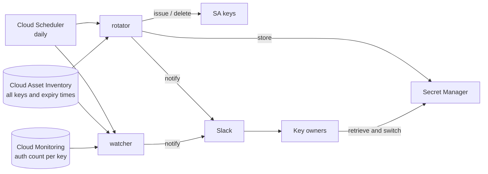

## Overview

I built a system that automatically rotates Google Cloud service account keys (SA keys) while keeping them expiring.

An organization policy enforces a maximum key lifetime of 90 days, and two batch jobs run daily on Cloud Run jobs:

- **rotator**: issues the next key once a key is 30 days old, and deletes expired keys
- **watcher**: notifies Slack about keys that are close to expiring but haven't been switched over yet

The rotator never disables keys. Disabling is left to expiry.

## Background

### Keys had an expiry, but nothing to renew them

An SA key is a JSON file that contains a service account's private key. Anyone who gets it can impersonate that service account, so our policy is to avoid them in principle. Still, some use cases genuinely need keys, such as integrations with tools running outside Google Cloud.

At one point, I tried to give one of those keys a one-year expiry. But the organization policy that sets key expiry, `iam.serviceAccountKeyExpiryHours`, caps out at 2160 hours (90 days). One year isn't an option.

So instead, I put the expiry on the role binding. But nobody had decided who would renew it, or how, when it expired. Left as is, the external tools would all lose access to Google Cloud on the same day.

What was missing was a way to renew before expiry.

## Approach

### Officially discouraged, but I chose expiring keys

Google's documentation recommends against using expiring service account keys for key rotation, because expiring keys can cause outages if they aren't rotated properly ([Rotate service account keys](https://docs.cloud.google.com/iam/docs/key-rotation)).

That's exactly the situation described above. I still chose expiring keys because I compared which way each option fails when the system breaks.

|                         | No expiry (official recommendation) | Expiring (adopted)                 |
| ----------------------- | ----------------------------------- | ---------------------------------- |
| If renewal stops        | A leaked key stays valid forever    | Always invalid within 90 days      |
| Weakness                | Old keys keep piling up             | Missed renewals cause outages      |

The risk of outages can be reduced with automation and monitoring. A leaked key that stays valid forever can't be undone after the fact.

Failing toward "unusable" when something breaks is called fail-closed, and failing toward "still usable" is called fail-open. I chose fail-closed and decided to handle the outage risk with the system itself.

### Add a new key every 30 days

For keys with a 90-day lifetime, the next key is issued once the current one is 30 days old.

```
Day       0         30        60        90        120
Key A     |-----------------------------| expires
Key B               |-----------------------------|
Key C                         |----------------------->
                    <-- 60-day grace --->
```

The new key arrives 60 days before the old one expires. Teams using the key won't break as long as they switch within those 60 days.

Whether to issue is decided every day, not on a fixed date like "the 1st of each month." With a fixed date, slipping by a single day pushes the next issuance a month out and eats into the grace period.

Once we're used to operating this and switchovers happen faster, I'm also considering shortening the lifetime to 60 days (1440h). The grace period drops to 30 days, but a leaked key stays valid for less time too.

## How it works



### Separate the rotator and the watcher

The rotator and the watcher are separate jobs so that if one breaks, the other can notice. If the updater and the monitor were the same process, a broken thing would be monitoring itself.

On top of that, there's an alert on job failures themselves. On a day with no watcher notifications, this tells "nothing is wrong" apart from "the watcher has stopped."

### The rotator keeps no state

Every day, for each service account, the rotator looks at the newest valid key and issues the next one if it's at least 30 days old. It leaves two cases alone:

- Service accounts with no valid keys: so it doesn't revive a service account someone deliberately shut off
- Keys without an expiry: having no expiry is the problem in itself, so they need to move to expiring keys. But even if the rotator added a new key, it doesn't disable old ones, so the old key would stay valid. Instead, the watcher flags them, and a person handles the migration and deletes the old key

The only inputs are "the current list of keys" and "the current time." Nothing records how far things have progressed. If one day's run fails, the next day's run looks at the current state and picks up where it left off.

If storing to Secret Manager fails mid-issuance, the newly created key is deleted to roll back. A key that couldn't be stored can't be retrieved by anyone, so there's no point keeping it.

### New keys go into each project's Secret Manager

A new key is stored in Secret Manager in the same project as the key. That way, access can be limited by the owning team's permissions. Gathering them in one place would turn it into a vault holding every team's keys.

Google also recommends against storing SA keys in Secret Manager. The reasoning is that "if an identity can read the secret, it shouldn't need a key in the first place." Here, the one reading the secret is the person doing the switchover, and the one using the key is a tool outside Google Cloud, so that reasoning doesn't apply.

### The watcher verifies switchovers with authentication data

Whether a switchover is done is decided by each key's authentication history, not by asking people to report it. Cloud Monitoring's `iam.googleapis.com/service_account/key/authn_events_count` records the number of authentications per key ([docs](https://docs.cloud.google.com/monitoring/api/metrics_gcp_i_o)).

On the day a key has 15 days left, and every day once it has fewer than 7 days left, the watcher notifies only if the key matches one of these:

| State                                                  | Meaning                                  |
| ------------------------------------------------------ | ---------------------------------------- |
| There's no new key                                     | Nothing to switch to                     |
| The new key has never been used                        | Nobody has switched yet                  |
| The old key is still used after the new key started    | Some system was missed in the switchover |

The watcher looks at the full 42 days of data this metric retains, so it catches jobs that run only once a month. If it can't fetch the authentication data, it notifies and then fails the job. Noisy is better than missing something.

One gap remains. If one key is shared across multiple systems, and the one that missed the switchover hasn't run even once since the new key started being used, the authentication data can't tell the difference. That's covered by an operational rule: one key per system.

## Walls I hit

### Dropping automatic disabling of old keys

The original rotator also disabled old keys: "Disable the old key 8 days after the new key starts being used, unless the old key was used in the last 7 days."

In review, though, someone asked: "Wouldn't a 7-day check miss a job that only runs at the end of the month?"

They were right. Authentication data only tells you whether a key was used in the past, not whether it won't be used in the future. Extend the window, and a job with an even longer interval hits the same problem.

So I dropped disabling from the rotator and left it entirely to expiry. Old keys stay around until they expire, so even late switchovers don't break anything. The watcher reports missed switchovers.

As a result, the rotator got much simpler. Checking authentication data, warning before disabling, and calculating grace days were all no longer needed. Automation that disables production keys based on a guess does too much damage when the guess is wrong. I decided to leave that call to expiry, which always fires.

### The permission to issue keys was too broad

Issuing keys requires the `iam.serviceAccountKeyAdmin` role. I originally planned to grant it at the organization level, but a reviewer pointed out that it would allow issuing keys for any service account in the organization.

Granting the role only while the job runs was ruled out, because adding and removing it would require an even stronger permission. In the end, the role is granted only on the allowed service accounts.

The allowlist lives in two places: Terraform (permissions) and the app (rotator targets). It's duplicated, but I accepted that because a mismatch fails safe. If an account is only in the app, a permission error triggers an alert. If it's only in Terraform, no key is issued, and the watcher warns before expiry.

Other permissions are also limited to what's needed:

- Keys are listed with a custom role that can only see keys (the predefined `cloudasset.viewer` can see every resource)
- Secret Manager allows only "create" and "add version," and adding versions is limited to secrets whose names start with a fixed prefix

## Summary

- An organization policy enforces a 90-day expiry, so keys always expire even if renewal stops (fail-closed)
- The rotator only adds a new key every 30 days and never disables keys. Disabling is left to expiry
- Switchovers are verified by each key's authentication data, not by people reporting them
- With no state, a failed run is picked up by the next day's run
- Permissions are limited to allowed service accounts, so a config mismatch fails safe

## References

- Best practices for managing service account keys: https://docs.cloud.google.com/iam/docs/best-practices-for-managing-service-account-keys
- Rotate service account keys: https://docs.cloud.google.com/iam/docs/key-rotation
- Restricting service accounts (`iam.serviceAccountKeyExpiryHours`): https://docs.cloud.google.com/resource-manager/docs/organization-policy/restricting-service-accounts
- Google Cloud metrics (`authn_events_count`): https://docs.cloud.google.com/monitoring/api/metrics_gcp_i_o
