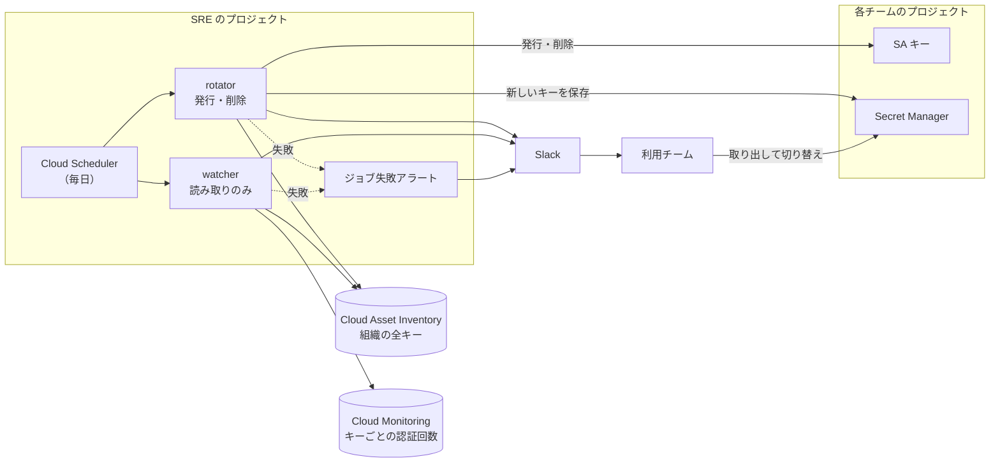
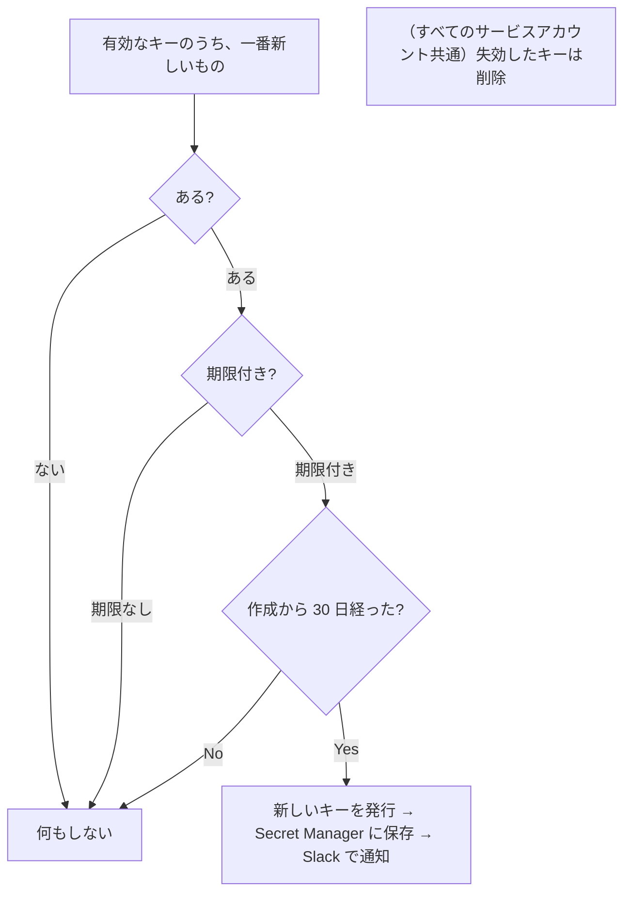

## 概要

GCP のサービスアカウントキー（以下、SA キー）を、期限付きのまま自動で回す仕組みを作りました。

キーの寿命は、組織ポリシーで最長 90 日に強制しています。期限切れで止まらないように、毎日新しいキーを発行する「rotator」と、切り替え漏れを知らせる「watcher」の 2 つのバッチを Cloud Run jobs で動かしています。

rotator は、キーを止めることはしません。やるのは「新しいキーを足す」と「失効したキーを消す」の 2 つだけです。キーを止めるのは、期限による失効に任せています。

当初は「使われなくなった旧キーを rotator が自動で無効化する」設計でした。しかしレビューで「月末だけ動く処理を見逃すのでは？」と指摘を受け、この設計はやめています。

あわせて、方針を ADR（設計判断の記録）にまとめ、開発者向けの運用マニュアルも用意しました。これまで一部のチームが自前のワークフローで回していたキー更新も、この仕組みに載せ替えていきます。

この記事では、この構成に至った経緯と仕組み、ぶつかった壁について書いていきます。

## 背景

### 期限を付けて、そのまま放置していた

SA キーは、サービスアカウントの秘密鍵が入った JSON ファイルです。漏れると誰でもそのサービスアカウントになりすませるので、社内では原則禁止にしています。

ただ、GCP の外で動くツールとの連携など、どうしてもキーが必要な用途が残っていました。

あるとき、そうしたキーに 1 年以上の期限を付けようとしました。期限を付ける手段は組織ポリシー `iam.serviceAccountKeyExpiryHours` しかありませんが、その上限は 2160 時間（90 日）です。1 年は設定できず、エラーになりました。

そこで代わりに、キーではなく「ロールの付与」に 13 ヶ月の期限を付けました。ただ、期限が来たときに誰がどう更新するかは決めていませんでした。

13 ヶ月後、5 つのプロジェクトのロールが同じ日に一斉に切れ、外部ツールから GCP を呼べなくなりました。

つまり、問題は「期限を付けたこと」ではなく、「期限を付けたのに更新する仕組みを作らなかったこと」だったということです。

### キーは想定の 5 倍あった

事故のあと、組織全体のキーを洗い出しました。

想定では 22 本でしたが、実際には約 120 本ありました。しかも、そのほとんどが期限なしでした。

## 方針

### 公式は非推奨だが、期限付きを選んだ

実は Google 公式は、期限付きキーを推奨していません。

> 期限付きキーをローテーションに使うことは推奨しない。正しく回さないと停止を招くため
> （[Rotate service account keys](https://docs.cloud.google.com/iam/docs/key-rotation) より要約）

まさに今回の事故そのものです。それでも期限付きを選んだのは、仕組みが壊れたときにどちらへ倒れるかを比べたからです。

|                  | 期限なし（公式推奨）   | 期限付き（採用）     |
| ---------------- | ---------------------- | -------------------- |
| 更新が止まったら | 漏れたキーが永久に有効 | 最長 90 日で必ず無効 |
| 弱点             | 古いキーが溜まり続ける | 更新が漏れると止まる |

「止まる」リスクは、自動化と監視で防げます。一方で「漏れたキーが永久に使える」状態は、あとから取り返せません。

壊れたときに「使えなくなる」側に倒れることを fail-closed、「使えたまま」の側に倒れることを fail-open と呼びます。今回は fail-closed を選び、止まるリスクを仕組みで潰す方針にしました。

### 30 日ごとに新しいキーを足す

寿命 90 日のキーに対して、作成から 30 日経ったら次のキーを発行します。

```
日     0          30          60          90
キーA  作成 ────────────────────────────── 失効 → 削除
キーB             作成 ──────────────────────────────── (120 日目に失効)
キーC                         作成 ──────────────────── (150 日目に失効)
                  ↑
         キーA が失効するまで 60 日の猶予がある
```

新しいキーは、古いキーが失効する 60 日前に届きます。利用チームは、その 60 日の間に切り替えればよいということです。

発行するかどうかは、「毎月 1 日」のような決まった日ではなく、毎日判定しています。決まった日に発行する方式だと、切り替えが数日遅れただけで次の発行が 1 ヶ月先になり、猶予が削られてしまうからです。

### 見送った案

| 案                                                  | 見送った理由                                                         |
| --------------------------------------------------- | -------------------------------------------------------------------- |
| Security Command Center（GCP のセキュリティ管理機能）で検知する | キーの発行（rotator の役割）はできない。監視だけを任せても、仕組みが 2 か所に分かれるだけになる |
| 切り替えの確認に Activity Analyzer（キーの最終使用日）を使う | 日単位でしか分からず、まだ正式リリース前（Pre-GA）だった             |
| 切り替えの完了をスプレッドシートで管理する          | 人の記憶に頼る運用に戻ってしまう                                     |

## アーキテクチャ

### 全体図



| 登場人物              | 役割                                                         |
| --------------------- | ------------------------------------------------------------ |
| rotator               | 新しいキーを発行して Secret Manager に保存し、Slack で知らせる。失効したキーは消す |
| watcher               | 失効が近いのに、まだ切り替わっていないキーを Slack で知らせる |
| Cloud Asset Inventory | 組織内のすべてのキーと、その失効日時を一覧できる             |
| Cloud Monitoring      | キーごとの認証回数（`authn_events_count`）を記録している     |
| Secret Manager        | 新しいキーの置き場所。利用チームはここから取り出す           |

### なぜこの形なのか

rotator と watcher を別のジョブに分けているのは、片方が壊れても、もう片方が気づけるようにするためです。更新する側と監視する側が同じプロセスだと、壊れたものが自分を監視することになってしまいます。

ジョブ失敗アラートを付けているのは、watcher の通知がない日に「問題がない」のか「watcher が止まっている」のかを区別するためです。

実行基盤に Cloud Run jobs を選んだのは、毎日起動して全キーを確認し、終わったら止まるバッチ処理だからです。Cloud Run functions も候補でしたが、こちらはイベントに応答する用途向けです。今回はイベントを起点にしないので見送りました。

新しいキーの置き場所は、キーがあるプロジェクトの Secret Manager です。読める人をそのチームの権限で絞れるからです。1 か所に集めると、そこが全チームのキーの金庫になってしまいます。

なお、SA キーを Secret Manager に置くことも、公式は推奨していません。理由は「Secret を読める ID があるなら、そもそもキーは要らないはず」だからです。今回は、Secret を読むのは切り替え作業をする人で、キーを使うのは GCP の外のツールです。この理由は当てはまらないので、採用しました。

キーの一覧は、Cloud Asset Inventory の `ListAssets` で取っています。似た API に `SearchAllResources` がありますが、こちらはキーの失効日時を返さないので使えませんでした。

### rotator の判断

rotator は毎日、サービスアカウントごとに次の判断をします。



有効なキーがないサービスアカウントには、発行しません。人が意図的に止めたサービスアカウントを、勝手に復活させないためです。

期限なしのキーにも触りません。どのシステムで使われているか分からないので、watcher が知らせて人が移行します。

この判断は、「キーの一覧と今の時刻を受け取って、今日やることを返す」1 つの関数だけで書いています。データベースも、「どこまで進んだか」の記録も持っていません。

そのため、ある日の実行が失敗しても、翌日の実行が今のキーの状態を見て、続きを正しく進めます。

発行の途中で失敗したときは、作ったキーを消して元に戻します。Secret Manager への保存に失敗したキーは誰も取り出せないので、残しておく意味がないからです。

### コードの作り

rotator と watcher は Go で書いています。

判断のルールは、GCP にも Slack にも依存しない 1 つのパッケージにまとめました。今の時刻も引数で受け取るので、「90 日後にどうなるか」のようなケースも、GCP なしでテストできます。

```
cmd/rotator, cmd/watcher   … GCP や Slack を呼んで、判断の結果を実行する
internal/sakey             … 判断のルールだけ（外部に依存しない）
internal/gcp, internal/slack … 外部サービスとのやり取り
```

インフラは Terraform で管理し、アプリは main へのマージで検証環境、タグを打つと本番にデプロイされるようにしています。

### watcher の判断

切り替えが済んだかどうかは、人に申告してもらうのではなく、キーの認証実績で判断しています。

Cloud Monitoring の `iam.googleapis.com/service_account/key/authn_events_count` は、キーごとの認証回数を記録しています（[公式](https://docs.cloud.google.com/monitoring/api/metrics_gcp_i_o)）。

watcher は失効が近いキー（残り 15 日の日と、残り 7 日以降は毎日）について、次のどれかに当てはまるときだけ通知します。

| 状態                                               | 意味                             |
| -------------------------------------------------- | -------------------------------- |
| 新しいキーがない                                   | 切り替え先がない                 |
| 新しいキーが一度も使われていない                   | まだ誰も切り替えていない         |
| 新しいキーを使い始めた後も、古いキーが使われている | 切り替え忘れのシステムが残っている |

認証実績は、この指標が残っている期間いっぱいの 42 日分を見ています。月に 1 回しか動かない処理も拾えるようにするためです。

認証実績が取れなかったときは、通知したうえでジョブを失敗させます。見逃すよりは、うるさいほうがよいからです。

ただ、この判定にも見逃しが 1 つあります。1 本のキーを複数のシステムで使い回していて、切り替え忘れたほうのシステムが「新しいキーを使い始めた日」以降に一度も動いていない場合です。認証実績からは区別できないので、ここは「キーはシステムごとに分ける」という運用ルールでカバーしています。

## ぶつかった壁

### 旧キーの自動無効化をやめた

当初の rotator は、旧キーの無効化までやる設計でした。

「新しいキーが使われ始めてから 8 日経ったら、旧キーを無効化する。ただし、直近 7 日の間に旧キーが使われていたら見送る」というものです。

ところがレビューで、「月末だけ動く処理は、7 日の確認では見逃すのでは？」と指摘を受けました。

その通りでした。認証実績から分かるのは「過去に使われたかどうか」だけで、「今後も使われないこと」までは分かりません。確認の期間を延ばしても、もっと間隔の空く処理があれば同じことが起きます。

そこで、rotator による無効化はやめることにしました。キーを止めるのは、期限による失効だけです。

```
変更前: rotator が「もう使われていない」と推測して旧キーを止める
変更後: rotator は止めない。旧キーは期限が来たら自然に失効する
```

旧キーは失効まで残るので、遅れて切り替えた処理も止まりません。切り替え漏れの監視は、watcher に任せました。

結果として、rotator はかなり単純になりました。認証実績を見る処理も、無効化を予告する通知も、猶予日数の計算も、すべて不要になったからです。

推測に基づいて本番のものを止める自動化は、推測が外れたときの被害が大きいです。止める判断は、確実に動く仕組み（期限）に任せるほうが安全だと考えています。

### キーを発行する権限が強すぎた

rotator がキーを発行するには、`iam.serviceAccountKeyAdmin` というロールが必要です。

当初はこれを組織全体に付けるつもりでしたが、レビューで「それだと組織内のどのサービスアカウントのキーでも発行できてしまう」と指摘を受けました。

そこで、次の 3 つの案を比べました。

| 案                                         | 判断 | 理由                                                         |
| ------------------------------------------ | ---- | ------------------------------------------------------------ |
| 実行するときだけ権限を付け外しする         | ×    | 権限を付け外しするための、もっと強い権限が rotator に必要になる |
| 時間帯の条件を付けて、実行時間だけ許可する | ×    | 起動の遅れや再実行で時間外になると失敗する                   |
| **許可したサービスアカウントにだけ付ける** | ○    |                                                              |

許可したサービスアカウントの一覧は、Terraform（権限）とアプリ（rotator の対象）の 2 か所に持っています。

二重管理にはなりますが、ずれても安全な側に倒れるので許容しました。アプリ側にだけあるものは、権限エラーでアラートが鳴ります。Terraform 側にだけあるものは、キーが発行されないだけで、watcher が失効前に知らせてくれます。

ほかの権限も、必要な分だけに絞っています。

- キーの一覧は、キーだけを見られるカスタムロールで取る（既製の `cloudasset.viewer` だと全リソースが見えてしまう）
- Secret Manager は「作成」と「値の追加」だけを許可する。値の追加は、名前が `SA_KEY_` で始まる Secret だけに限定する

### 期限なしのキーができてしまった

キーを作る API には、期限を指定する引数がありません。期限は、組織ポリシーでしか付けられないのです。

そのため、ポリシーが設定されていないプロジェクトで rotator を動かすと、期限なしのキーができてしまいます。実際、検証環境で起きました。

対処として、発行したキーに期限が付いていなければ、すぐに削除してジョブを失敗させるようにしました。放っておくと、期限なしのキーが 30 日ごとに増えてしまうからです。

あわせて、組織全体に 90 日の期限を強制しました。

注意したいのは、このポリシーが効くのは新しく作るキーだけということです。すでにある期限なしのキーには効きません。既存のキーは、別途洗い出して移行しています。

### 期限の値は自由に選べなかった

組織ポリシーの値は、`1h / 8h / 24h / 168h / 336h / 720h / 1440h / 2160h` の中から選ぶ形式です（[公式](https://docs.cloud.google.com/resource-manager/docs/organization-policy/restricting-service-accounts)）。75 日のような値は指定できません。

一部のプロジェクトは 60 日（1440h）に設定されていました。ただ、60 日だと月に 1 回しか動かない処理では切り替えの確認が間に合わず、毎回誤報が出てしまいます。

そこで、利用チームと合意したうえでプロジェクト単位の設定を消し、組織全体の 90 日に揃えました。

### 毎朝 100 行以上の通知が流れた

watcher を動かし始めると、期限なしのキー約 120 本の通知が、毎朝すべて流れてきました。これでは、本当に対応が必要な通知が埋もれてしまいます。

そこで、次のように絞りました。

- 状態が変わらない期限なしのキーは、月曜日だけ知らせる
- 失効が近いキーも、切り替え漏れがあるときだけ知らせる

「通知が来たら、対応が必要」と言える状態を目指しています。

## まとめ

- SA キーは組織ポリシーで 90 日の期限を強制し、更新が止まっても必ず失効する（fail-closed）ようにした
- rotator は 30 日ごとに新しいキーを足すだけで、止めることはしない。キーを止めるのは期限に任せた
- 切り替えの確認は、人の申告ではなく、キーごとの認証実績で判断している
- 状態を持たない作りにしたことで、途中で失敗しても翌日の実行で続きから進む
- 権限は許可したサービスアカウントだけに絞り、設定がずれても安全な側に倒れるようにした

現在、watcher は本番で毎朝動いています。rotator も本番にデプロイ済みで、既存のキーを整理しながら対象を順に増やしているところです。

同じようなことをする場合は、まず全体のキーを洗い出すところから始めるのがおすすめです。今回は想定の 5 倍あり、通知の設計も移行の計画も変わりました。

## 参考

- Best practices for managing service account keys: https://docs.cloud.google.com/iam/docs/best-practices-for-managing-service-account-keys
- Rotate service account keys: https://docs.cloud.google.com/iam/docs/key-rotation
- Restricting service accounts（`iam.serviceAccountKeyExpiryHours`）: https://docs.cloud.google.com/resource-manager/docs/organization-policy/restricting-service-accounts
- Google Cloud metrics（`authn_events_count`）: https://docs.cloud.google.com/monitoring/api/metrics_gcp_i_o
