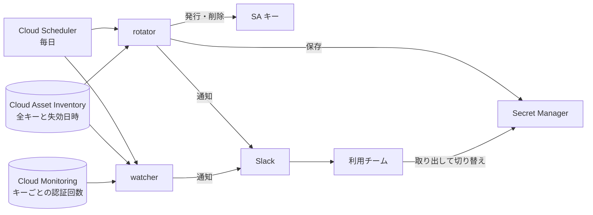

## 概要

Google Cloud のサービスアカウントキー（以下、SA キー）を、期限付きのまま自動で回す仕組みを作りました。

キーの寿命は組織ポリシーで最長 90 日に強制し、次の 2 つのバッチを Cloud Run jobs で毎日動かしています。

- **rotator**：作成から 30 日経ったキーの次のキーを発行し、失効したキーを消す
- **watcher**：失効が近いのに切り替わっていないキーを Slack で知らせる

rotator はキーを止めません。止めるのは期限による失効だけに任せています。

## 背景

### 期限を付けたのに、更新する仕組みがなかった

SA キーは、サービスアカウントの秘密鍵が入った JSON ファイルです。漏れると誰でもそのサービスアカウントになりすませるので、原則として使わない方針にしています。ただ、Google Cloud の外で動くツールとの連携など、どうしてもキーが必要な用途は残っていました。

あるとき、そうしたキーに 1 年の期限を付けようとしました。しかし、キーに期限を付ける組織ポリシー `iam.serviceAccountKeyExpiryHours` の上限は 2160 時間（90 日）で、1 年は設定できません。

そこで代わりに、ロールの付与のほうに期限を付けました。ただ、期限が来たら誰がどう更新するかは決めていませんでした。このままでは、期限の日に外部ツールから Google Cloud を一斉に呼べなくなります。

問題は期限を付けたことではなく、更新する仕組みを作らなかったことです。

## 方針

### 公式は非推奨だが、期限付きを選んだ

Google 公式は、期限付きキーでのローテーションを推奨していません。

> 鍵のローテーションに有効期限付きのサービス アカウント キーを使用することはおすすめしません。有効期限付きの鍵の場合、適切にローテーションされないと停止する可能性があります。
> （[サービス アカウント キーのローテーション](https://docs.cloud.google.com/iam/docs/key-rotation?hl=ja) より引用）

期限を付けたまま更新の仕組みがない、という今回の状況がまさにそれです。それでも期限付きを選んだのは、仕組みが壊れたときにどちらへ倒れるかを比べたからです。

|                  | 期限なし（公式推奨）   | 期限付き（採用）     |
| ---------------- | ---------------------- | -------------------- |
| 更新が止まったら | 漏れたキーがずっと有効 | 最長 90 日で必ず無効 |
| 弱点             | 古いキーが溜まり続ける | 更新が漏れると止まる |

止まるリスクは、自動化と監視で減らせます。漏れたキーがずっと使える状態は、あとから取り返せません。

壊れたときに「使えなくなる」側に倒れることを fail-closed、「使えたまま」の側に倒れることを fail-open と呼びます。今回は fail-closed を選び、止まるリスクのほうを仕組みで潰すことにしました。

### 30 日ごとに新しいキーを足す

寿命 90 日のキーに対して、作成から 30 日経ったら次のキーを発行します。

```
経過日数   0         30         60         90        120
キー A     ├──────────────────────────────────┤ 失効
キー B               ├──────────────────────────────────┤
キー C                          ├────────────────────────…
                     └──── 切り替えの猶予 60 日 ────┘
```

新しいキーは、古いキーが失効する 60 日前に届きます。利用チームは、その 60 日のうちに切り替えれば止まりません。

発行するかどうかは「毎月 1 日」のような決まった日ではなく、毎日判定しています。決まった日だと、1 日ずれただけで次の発行が 1 か月先になり、猶予が削られるからです。

運用に慣れて切り替えが早く済むようになったら、寿命を 60 日（1440h）に縮めることも考えています。猶予は 30 日に減りますが、漏れたときに有効な期間も短くなります。

## 仕組み



### rotator と watcher を分ける

rotator と watcher を別のジョブにしているのは、片方が壊れてももう片方が気づけるようにするためです。更新する側と監視する側が同じプロセスだと、壊れたものが自分を監視することになります。

さらに、ジョブ自体の失敗にもアラートを付けています。watcher の通知がない日に、「問題がない」のか「watcher が止まっている」のかを区別するためです。

### rotator は状態を持たない

rotator は毎日、サービスアカウントごとに一番新しい有効なキーを見て、作成から 30 日経っていれば次のキーを発行します。ただし、次の 2 つには触りません。

- 有効なキーが 1 本もないもの：人が意図的に止めたサービスアカウントを勝手に復活させないため
- 期限なしのキー：どこで使われているか分からないので、watcher が知らせて人が移行する

判断に使うのは「今あるキーの一覧」と「今の時刻」だけで、「どこまで進んだか」は保存していません。ある日の実行が失敗しても、翌日の実行が今の状態を見て続きを進めます。

発行の途中で Secret Manager への保存に失敗したときは、作ったキーを消して元に戻します。保存できなかったキーは誰も取り出せないので、残す意味がないからです。

新しいキーは、そのキーがあるプロジェクトの Secret Manager に置きます。読める人をそのチームの権限で絞れるからです。1 か所に集めると、そこが全チームのキーの金庫になってしまいます。

なお、SA キーを Secret Manager に置くことも公式は推奨していません。「Secret を読める ID があるなら、そもそもキーは要らないはず」という理由です。今回は、Secret を読むのは切り替え作業をする人で、キーを使うのは Google Cloud の外のツールなので、この理由は当てはまりません。

### watcher は認証実績で切り替えを確かめる

切り替えが済んだかどうかは、人に申告してもらうのではなく、キーの認証実績で判断しています。Cloud Monitoring の `iam.googleapis.com/service_account/key/authn_events_count` に、キーごとの認証回数が記録されています（[公式](https://docs.cloud.google.com/monitoring/api/metrics_gcp_i_o)）。

watcher は、失効が近いキー（残り 15 日の日と、残り 7 日からは毎日）が次のどれかに当てはまるときだけ通知します。

| 状態                                               | 意味                               |
| -------------------------------------------------- | ---------------------------------- |
| 新しいキーがない                                   | 切り替え先がない                   |
| 新しいキーが一度も使われていない                   | まだ誰も切り替えていない           |
| 新しいキーを使い始めた後も、古いキーが使われている | 切り替え忘れのシステムが残っている |

認証実績は、この指標が保持される 42 日分をすべて見ています。月 1 回しか動かない処理も拾うためです。認証実績が取れなかったときは、通知したうえでジョブを失敗させます。見逃すより、うるさいほうがましだからです。

それでも見逃しが 1 つ残ります。1 本のキーを複数のシステムで使い回していて、切り替え忘れたほうが「新しいキーを使い始めた日」以降に一度も動いていない場合です。認証実績からは区別できないので、「キーはシステムごとに分ける」という運用ルールで補っています。

## ぶつかった壁

### 旧キーの自動無効化をやめた

当初の rotator は、旧キーの無効化までやる設計でした。「新しいキーが使われ始めて 8 日経ったら旧キーを無効化する。ただし直近 7 日に旧キーが使われていたら見送る」というものです。

ところがレビューで、「月末だけ動く処理は、7 日の確認では見逃すのでは？」と指摘されました。

その通りでした。認証実績から分かるのは「過去に使われたか」だけで、「今後も使われないか」は分かりません。確認期間を延ばしても、もっと間隔の空く処理があれば同じことが起きます。

そこで、rotator による無効化はやめ、キーを止めるのは期限による失効だけにしました。旧キーは失効まで残るので、遅れて切り替えた処理も止まりません。切り替え漏れは watcher が知らせます。

結果として、rotator はかなり単純になりました。認証実績を見る処理も、無効化の予告も、猶予日数の計算も要らなくなったからです。推測で本番のものを止める自動化は、推測が外れたときの被害が大きくなります。止める判断は、確実に動く仕組み（期限）に任せるほうが安全です。

### キーを発行する権限が強すぎた

キーの発行には `iam.serviceAccountKeyAdmin` ロールが必要です。当初は組織全体に付けるつもりでしたが、レビューで「組織内のどのサービスアカウントのキーでも発行できてしまう」と指摘されました。

実行時だけ付け外しする案は、付け外しのためにもっと強い権限が要るので見送りました。最終的に、許可したサービスアカウントにだけロールを付けています。

許可の一覧は、Terraform（権限）とアプリ（rotator の対象）の 2 か所にあります。二重管理ですが、ずれても安全な側に倒れるので許容しました。アプリ側にだけあれば権限エラーでアラートが鳴り、Terraform 側にだけあればキーが発行されず、watcher が失効前に知らせます。

ほかの権限も必要な分だけに絞っています。

- キーの一覧は、キーだけを見られるカスタムロールで取る（既製の `cloudasset.viewer` では全リソースが見えてしまう）
- Secret Manager は「作成」と「値の追加」だけを許可し、値の追加は決まった接頭辞で始まる名前の Secret に限る

## まとめ

- 組織ポリシーで 90 日の期限を強制し、更新が止まっても必ず失効する（fail-closed）ようにした
- rotator は 30 日ごとに新しいキーを足すだけで、止めない。止めるのは期限に任せた
- 切り替えの確認は、人の申告ではなくキーごとの認証実績で行う
- 状態を持たない作りなので、途中で失敗しても翌日の実行で続きから進む
- 権限は許可したサービスアカウントだけに絞り、設定がずれても安全な側に倒れるようにした

## 参考

- Best practices for managing service account keys: https://docs.cloud.google.com/iam/docs/best-practices-for-managing-service-account-keys
- Rotate service account keys: https://docs.cloud.google.com/iam/docs/key-rotation
- Restricting service accounts（`iam.serviceAccountKeyExpiryHours`）: https://docs.cloud.google.com/resource-manager/docs/organization-policy/restricting-service-accounts
- Google Cloud metrics（`authn_events_count`）: https://docs.cloud.google.com/monitoring/api/metrics_gcp_i_o
