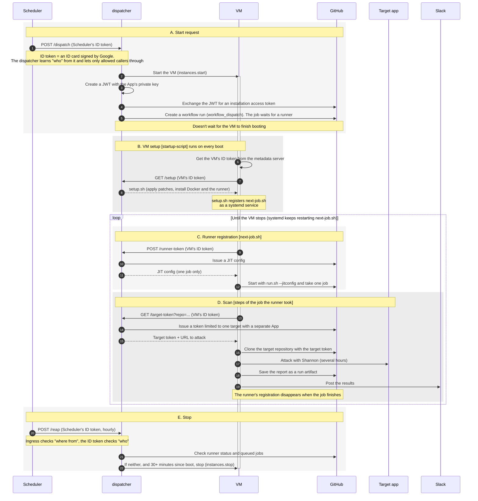
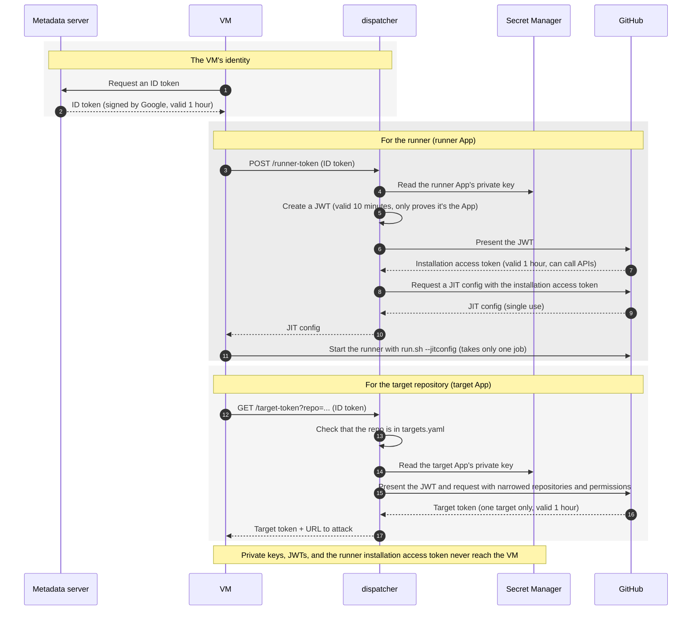

## Overview

I built a platform on Google Cloud that runs the OSS AI pentester [Shannon](https://github.com/KeygraphHQ/shannon) against our staging environments on a schedule. I handled everything from design to implementation on my own, using Go, Terraform, and GitHub Actions.

At first, I planned to build it on Cloud Run Jobs. However, Shannon starts its own containers while it runs, so it needs a privileged container. Cloud Run doesn't support that.

In the end, I went with a setup that just starts and stops a single GCE VM, and uses that VM as a GitHub Actions self-hosted runner. GitHub handles the job queue, so I didn't have to build a queueing system myself.

## Background

Penetration testing (a security assessment that actually attacks a system to find holes) is usually "outsourced once a year." In the meantime, the code changes hundreds of times.

If AI is making attackers faster and cheaper, I thought defenders also need to check continuously.

So I decided to adopt the idea of CTEM (Continuous Threat Exposure Management). CTEM is a program for continuously managing your exposure to threats, and it consists of five phases. Setting up all of them at once would be too heavy, so I started with just the Validation phase, which checks "whether an attack actually gets through."

I chose Shannon as the tool. It reads the source code to find attack paths, actually tries the attacks, and reports only the ones that succeed. Because it's OSS, the only cost is the LLM usage fee. Many commercial AI pentests cost thousands of dollars per run, so the difference was an order of magnitude.

## Technology choices

### The Cloud Run plan fell apart

Since the job is "start, run, finish," I initially thought Cloud Run Jobs would be a perfect fit.

However, when I read Shannon's source before starting on the Terraform, I found that it calls `docker run` itself to start containers while it runs. In other words, it needs a privileged container (a container with strong, near-host-level privileges) to run Docker inside the execution environment.

Cloud Run, on the other hand, officially [does not support privileged containers](https://cloud.google.com/run/docs/container-contract). At that point, I knew the Cloud Run plan wouldn't work.

### A VM by process of elimination

I ruled out the other candidates one by one.

| Candidate | Why I ruled it out |
| -- | -- |
| Cloud Run | No support for privileged containers |
| GKE Autopilot | Privileged Pods require changing an organization policy. The company has also already moved from GKE to Cloud Run |
| GKE Standard | The nodes are VMs anyway, so it doesn't reduce the operational work. The company has also already moved from GKE to Cloud Run |
| GitHub-hosted runner | Can't pin the source IP (the target's WAF uses an IP allowlist) |
| Vendor's SaaS version | Source code and attack results would pass through an outside company |

What was left was a GCE VM.

### Running it on GitHub Actions

I chose GitHub Actions for two reasons.

- There's an official Action: Shannon's official GitHub Action ([shannon-action](https://github.com/KeygraphHQ/shannon-action)) can be used as is
- GitHub can handle the queue: GitHub assigns jobs one at a time to free runners, and [keeps jobs that can't find a runner waiting for up to 24 hours](https://docs.github.com/en/actions/reference/limits). With Pub/Sub, I would have to write a worker that receives messages and runs the scan, but the runner takes on that role. If we later add more targets and run them in parallel, the queue can stay as it is

When people hear "GitHub Actions," they may picture jobs running on GitHub's machines. But if you specify your own VM (a self-hosted runner) in `runs-on`, you can choose where the jobs run.

This time, I chose a self-hosted runner instead of GitHub's machines (GitHub-hosted runners), for two reasons.

- The source IP can be pinned: GitHub's machines get a different IP every time, so they can't be added to the WAF allowlist in front of the targets. With my own VM, the attacks come from Cloud NAT's static IP
- It can handle long scans: on GitHub's machines, a job can run for [at most 6 hours](https://docs.github.com/en/actions/reference/limits). A scan takes several hours, so there isn't enough headroom

### Disposable JIT runners, one job at a time

There are two ways to register a self-hosted runner with GitHub, and the only difference is "who does the registration."

```
registration token method: the manager gets a registration token (a registration-only token) → the runner registers itself with it
JIT config method        : the manager completes the registration                         → the runner just starts
```

Here, the dispatcher is the manager. It creates a JWT with the GitHub App's private key, exchanges it for an installation access token, and calls `generate-jitconfig` with that, which returns a JIT config with the registration already done. The VM just passes it to `run.sh --jitconfig`. The runner is registered as a disposable runner that can take only one job, and the registration disappears when the job finishes.

I chose JIT config because it means I don't have to give the VM a "key that can register runners."

### Borrowing the ARC idea on a small scale

This pattern of "prepare a runner when a job comes in, and throw it away after one job" is the same idea as GitHub's official [ARC (Actions Runner Controller)](https://docs.github.com/en/actions/concepts/runners/actions-runner-controller). ARC is a system on Kubernetes that scales disposable runner Pods up and down based on the number of jobs.

| ARC | This setup |
| -- | -- |
| The listener waits for jobs and decides how many runners to run | The dispatcher starts the VM and stops it during hourly checks |
| The controller fetches a JIT config and creates a runner Pod | The dispatcher issues a JIT config, and the VM starts a runner with it |
| The runner Pod is deleted when the job finishes | The runner's registration disappears when the job finishes, and a new one is created |

I didn't use ARC itself because it assumes Kubernetes. I had already ruled out GKE for the reasons above, and ARC's listener has to be running all the time. Since this only runs three times a month, switching between "zero or one VM" was enough. If I want to run multiple targets in parallel, moving to ARC is the next option.

## Architecture

A control tower written in Go (the dispatcher) runs on Cloud Run and handles starting and stopping the VM, starting workflows, and issuing tokens. The VM has no external IP and attacks from Cloud NAT's static IP.

### The flow of one scan



**A. Start request (1–5)**: After starting the VM, the dispatcher doesn't wait for it to finish booting and immediately creates a workflow run with `workflow_dispatch`. It doesn't need to wait because the job doesn't start at this point; GitHub keeps it waiting until a runner shows up. Because the triggers are gathered in one place, the dispatcher, the "VM start" and the "workflow start" can never get out of sync.

**B. VM setup (6–8)**: Without a service account key (a JSON file containing a private key), the VM can get an ID token signed by Google just by asking the metadata server (`metadata.google.internal`) over HTTP. Requests to the metadata server [never leave the physical host running the VM](https://cloud.google.com/compute/docs/metadata/overview), so the VM's identity is guaranteed by the platform rather than by a key. The startup-script attaches this ID token, fetches setup.sh from the dispatcher, and runs it. That's all it does. setup.sh is embedded in the dispatcher's image, so merging to main takes effect from the next boot.

**C. Runner registration (9–12)**: From here on, it's not the startup-script but `next-job.sh`, which setup.sh registered with systemd, that runs. It asks the dispatcher for a JIT config and starts the runner.

**D. Scan (13–19)**: What runs here are the steps of the job the runner took. The target token (an installation access token) is the token the VM uses to clone the target repository. It is issued by a GitHub App separate from the runner one, and limited to just the one target repository (valid for 1 hour). The dispatcher issues it only when the repository name is in the reviewed target list (`targets.yaml`), and returns the URL to attack along with it. When the job finishes, the runner's registration disappears and systemd starts over from C, so waiting jobs are processed one by one by newly registered runners. Note that only the runner registration is disposable; the VM itself is reused until it is stopped.

**E. Stop (20–22)**: Every hour, the dispatcher checks the runner and the queued jobs, and stops the VM if there's no work.

## Design considerations

### Keep secrets off the attacking VM

The VM talks directly to the attack targets, so it's the easiest place in the system to compromise. On top of that, Shannon is an agent in which an LLM runs commands on its own. It could be tricked by instructions planted in the target's responses into sending keys on the VM to the outside. The VM has no external IP, so inbound traffic from the internet can't reach it, but outbound traffic can't be blocked because it's needed for the attacks and for calling the LLM.

So I deliberately did not give the VM's service account permission to read the GitHub App private keys. Even if the VM is compromised, Google Cloud IAM rejects the read on the server side.

Here are the tokens exchanged between the VM and the dispatcher.



The only GitHub keys the VM can get are the JIT config and the target token. The target token is narrowed to "only this repository, read-only" by [specifying `repositories` and `permissions` when it's issued](https://docs.github.com/en/rest/apps/apps#create-an-installation-access-token-for-an-app). The JIT config becomes unusable after one job, and the target token after one hour. No long-lived GitHub keys remain on the VM.

I also split the GitHub App into two, one per purpose. An App has a single set of permissions, which can't be changed per installation org. If I used one App for both, the target org would also get an unused "permission to register runners." Even if the issued tokens are narrowed, a leaked private key or a mistake in narrowing could let someone hijack the target org's jobs with a fake runner. I avoid granting permissions that aren't used, so as not to increase the attack surface.

Also, the URL to attack is not taken from the workflow inputs. Instead, the dispatcher returns the value from a reviewed config file. Even someone who can start the workflow can't attack an arbitrary URL.

The Google Cloud permissions are also kept to a minimum.

- The only VM the dispatcher can operate is this one
- The only things the dispatcher can read in Secret Manager are the two GitHub App private keys, not the whole project
- The VM has a dedicated service account and doesn't use the broadly privileged default service account

### Limiting who can call the dispatcher with ID tokens

The dispatcher is a key-issuing office that hands out JIT configs and target tokens, so I don't want anyone other than the Scheduler and the VM to call it.

So the permission to invoke it (`roles/run.invoker`) is granted only to specific service accounts, not to `allUsers`. In this case, the caller [must attach an ID token to show who it is](https://cloud.google.com/run/docs/authenticating/service-to-service).

As mentioned above, an ID token can be obtained just by asking the metadata server. There's no need to put a shared secret like an API key on the VM, and it expires in about an hour.

This checks something different from ingress: internal. Ingress looks at "where the request came from," and the ID token looks at "who made it," so I use both.

### Stopping the VM by "patrol," not by "time"

I decided how to stop the VM by comparing the costs of two failures.

| Failure | Loss |
| -- | -- |
| Forgetting to stop it | A few dollars a day |
| Stopping it mid-scan | Tens of dollars of LLM cost and several hours |

Stopping at a fixed time would also kill running scans. So the dispatcher patrols every hour and stops the VM only when "there are no running jobs and no waiting jobs."

One thing that tripped me up was that a JIT runner briefly disappears between jobs. If you only check "whether the runner is busy," you'll stop the VM in that gap. I solved it by also counting waiting jobs as work.

### Making it work even after six months of downtime

The VM only boots occasionally, so it has to work as is even after a long break.

So on every boot, it applies OS patches and reinstalls the latest runner. GitHub [stops giving jobs to outdated runners](https://docs.github.com/en/actions/reference/runners/self-hosted-runners#runner-software-updates-on-self-hosted-runners), so if you pin the version, it won't work six months later.

### No automatic retries

I deliberately didn't add retries to Cloud Scheduler. Retrying after a partial success would scan the same target twice and waste tens of dollars.

Since this only runs occasionally, it's cheaper to notice failures through alerts and have a person rerun it. To support that, the dispatcher outputs structured logs (JSON), and I set up an alert that notifies Slack when an error occurs.

### Stateless rotation

To keep LLM costs down, the target services are lined up in order and scanned one at a time, three times a month.

```
target = targets[(months elapsed × 3 + slot) % count]   * slot is 0, 1, or 2 (fixed to 3 Schedulers)
```

It doesn't store "how far it got last time." Because the target is determined only by the date, no database is needed, and we can announce "next month, it's this service" in advance.

## Walls I hit

### Calling the dispatcher from the VM returned 404

The dispatcher was set to be callable only from inside the VPC (ingress: internal). But when called from a VM on a Shared VPC, it returned 404, and not even a log was left in the app.

The cause was in the official docs. Requests from a Shared VPC are treated as "internal" only [when Cloud Run is attached to that Shared VPC](https://cloud.google.com/run/docs/securing/private-networking#shared-vpc), meaning it's configured to "send traffic to that VPC" with something like Direct VPC egress.

As the name suggests, Direct VPC egress is a setting for traffic "going out" from the dispatcher to the VPC. But this setting also serves as a marker that "the dispatcher belongs to this VPC," and it's used when deciding whether incoming traffic is internal. Requests from the VM don't go through the exit this setting creates; they still arrive at the dispatcher's URL as before. The only thing that changes is whether the incoming request is judged to be internal. The pitfall was that, because the dispatcher doesn't send any traffic into the VPC, I thought this setting was unnecessary.

I solved it by assigning a subnet for Direct VPC egress to the dispatcher.

## Summary

- Because Shannon needs a privileged container, I went with starting and stopping a single GCE VM instead of Cloud Run. It was important to check in the source what the tool needs before deciding where to run it
- I used GitHub Actions as a "job execution platform with a queue" and avoided building a queueing system myself
- The most dangerous component, the VM, only gets disposable, weak tokens. Strong permissions are confined to the dispatcher
- How to stop the VM and whether to retry were decided by comparing the costs of failure

## References

- Shannon: https://github.com/KeygraphHQ/shannon
- Cloud Run container runtime contract: https://cloud.google.com/run/docs/container-contract
- Cloud Run and Shared VPC: https://cloud.google.com/run/docs/securing/private-networking#shared-vpc
- GCE ID tokens: https://cloud.google.com/compute/docs/instances/verifying-instance-identity
- Cloud Run service-to-service authentication: https://cloud.google.com/run/docs/authenticating/service-to-service
- GitHub Actions JIT runners: https://docs.github.com/en/rest/actions/self-hosted-runners#create-configuration-for-a-just-in-time-runner-for-an-organization
- GitHub Actions limits: https://docs.github.com/en/actions/reference/limits
- Actions Runner Controller: https://docs.github.com/en/actions/concepts/runners/actions-runner-controller
