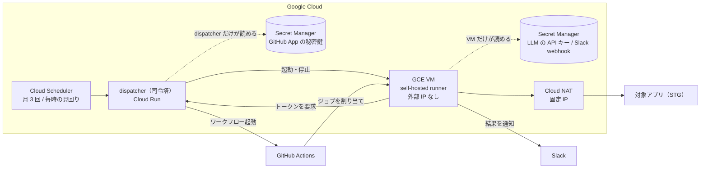
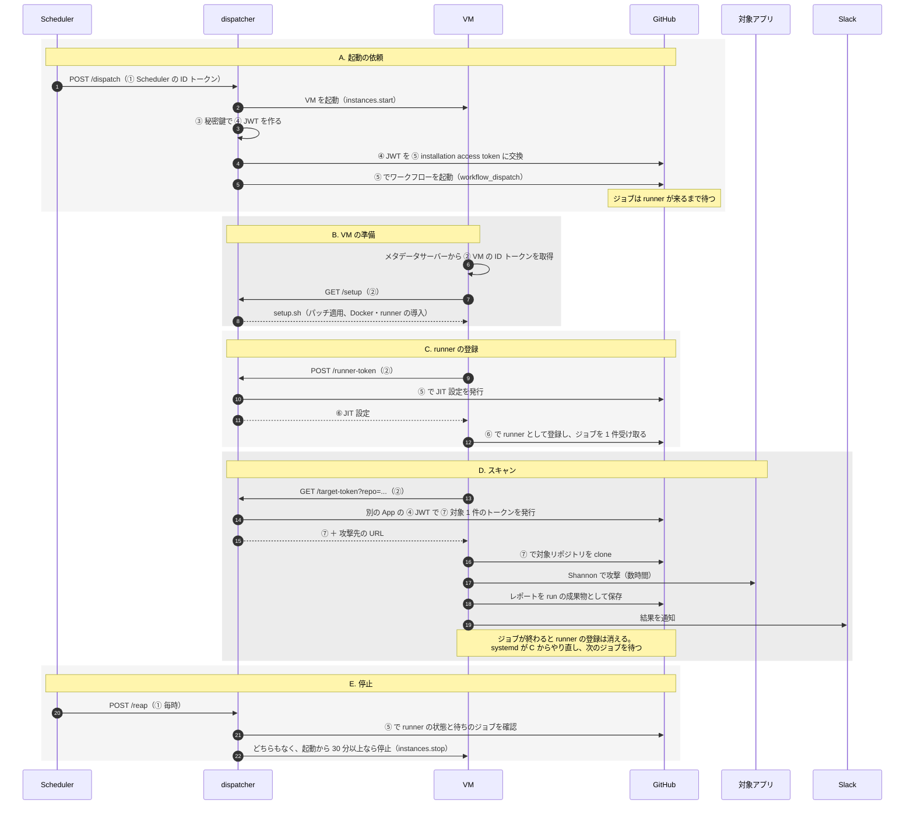

## 概要

OSS の AI ペンテスター [Shannon](https://github.com/KeygraphHQ/shannon) を、ステージング環境に対して定期実行する基盤を Google Cloud 上に作りました。設計から実装まで一人で担当し、Go・Terraform・GitHub Actions で構築しています。

当初は Cloud Run Jobs で作るつもりでした。ただ、Shannon は実行中に自分でコンテナを立てるため、特権コンテナが必要です。Cloud Run はこれに対応していません。

最終的に、GCE VM 1 台を起動・停止するだけの構成にし、その VM を GitHub Actions の self-hosted runner として使っています。ジョブのキュー管理は GitHub に任せているので、キューの仕組みを自作せずに済みました。

この記事では、この構成に至った経緯と仕組み、ぶつかった壁について書いていきます。

## 背景

ペネトレーションテスト（実際に攻撃して穴を探す診断）は、「年 1 回、外部に依頼する」のが一般的です。その間にも、コードは何百回も変わります。

AI によって攻撃する側が速く・安くなっているなら、守る側も継続的に確かめる必要があると考えました。

そこで、CTEM（Continuous Threat Exposure Management）の考え方を取り入れることにしました。CTEM は、脅威にさらされている状態を継続的に管理するためのプログラムで、5 つのフェーズからなります。全部を一度に整備するのは重いので、まずは「攻撃が本当に通るかを確かめる」Validation フェーズだけに絞りました。

ツールには Shannon を選びました。ソースコードを読んで攻撃経路を探し、実際に攻撃してみて、成功したものだけを報告してくれます。OSS なので費用は LLM の利用料だけです。商用の AI ペンテストは 1 回数千ドル規模のものが多く、桁が違いました。

## 手動で動かしてわかったこと

いきなり基盤を作るのではなく、まず検証用の VM で手動実行してみました。ここでわかったことが、そのまま要件になりました。

| わかったこと | 要件 |
| -- | -- |
| 対象の前段にある CDN / WAF は IP の許可リスト方式 | 送信元 IP を固定できる |
| CDN 事業者の規約で、無断のスキャンは禁止 | 事前の承認と社内告知を運用に組み込む |
| 1 回で数十ドルかかる | 勝手に再実行しない |
| 結果に過大評価や取りこぼしがある | 人がトリアージする前提にする |

## 技術選定

### Cloud Run 案が崩れた

「起動して、実行して、終わる」という処理なので、当初は Cloud Run Jobs がぴったりだと考えていました。

ところが、Terraform を書き始める前に Shannon のソースを読んでみると、実行中に自分で `docker run` を呼んでコンテナを立てる作りになっていました。つまり、実行環境の中で Docker を動かすための特権コンテナ（ホストに近い強い権限を持つコンテナ）が必要です。

一方、Cloud Run は公式に [privileged containers に対応していません](https://cloud.google.com/run/docs/container-contract)。この時点で Cloud Run 案は使えないことがわかりました。

### 消去法で VM に

ほかの候補も、要件に照らして 1 つずつ外していきました。

| 候補 | 外した理由 |
| -- | -- |
| Cloud Run | 特権コンテナに非対応 |
| GKE Autopilot | 特権 Pod を使うには組織ポリシーの変更が必要 |
| GKE Standard | ノードは結局 VM なので、運用の手間が減らない |
| Cloud Build Private Pools | Docker-in-Docker の扱いが公式に明記されていない |
| GitHub-hosted runner | 送信元 IP を固定できない |
| ベンダーの SaaS 版 | ソースコードと攻撃結果が社外を通る |

残ったのは GCE VM でした。社内には「VM はできるだけ避ける」という方針があったので、常時起動はせず、起動と停止だけを行う形にして運用の負担を減らしています。

### GitHub Actions で動かす

決め手になったのは、Shannon の公式 GitHub Action（`shannon-action`）があったことです。

「GitHub Actions を使う」というと、GitHub のマシンで動くイメージがあるかもしれません。ですが、`runs-on` で自前の VM（self-hosted runner）を指定すれば、実行場所は自分で選べます。

今回は、GitHub のマシン（GitHub-hosted runner）ではなく self-hosted runner を選びました。理由は次の 3 つです。

- 送信元 IP を固定できる：GitHub のマシンは IP が毎回変わるので、対象の前段にある WAF の許可リストに登録できない。自前の VM なら、Cloud NAT の固定 IP から攻撃できる
- 長時間のスキャンに耐えられる：GitHub のマシンでは、1 ジョブは[最大 6 時間](https://docs.github.com/en/actions/reference/limits)まで。スキャンは数時間かかるので余裕がない
- 秘密情報を GitHub に置かずに済む：VM は自分のサービスアカウントで Google Cloud に認証できる。API キーなどは Secret Manager から直接読めるので、GitHub の Secrets に登録しなくてよい

これには、もう 1 つ大きな利点がありました。GitHub は、空いている runner にジョブを 1 件ずつ割り当て、runner が見つからないジョブも[最大 24 時間待ってくれます](https://docs.github.com/en/actions/reference/limits)。つまり、キューを GitHub が肩代わりしてくれるということです。Pub/Sub とワーカーを自作せずに済みました。

### ARC の考え方を小さく借りる

この「ジョブが来たら runner を用意し、JIT で 1 ジョブだけ登録して、終わったら消す」という形は、GitHub 公式の [ARC（Actions Runner Controller）](https://docs.github.com/en/actions/concepts/runners/actions-runner-controller)と同じ考え方です。ARC は Kubernetes 上で、ジョブ数に応じて使い捨ての runner Pod を増減させる仕組みです。

| ARC | 今回 |
| -- | -- |
| listener がジョブを待ち受け、runner の数を決める | dispatcher が VM を起動し、毎時の見回りで止める |
| controller が JIT 設定を取得して runner Pod を作る | dispatcher が JIT 設定を発行し、VM がそれで runner を立てる |
| ジョブが終わると runner Pod を消す | ジョブが終わると runner の登録が消え、作り直す |

ARC そのものを使わなかったのは、Kubernetes が前提だからです。GKE は前述の理由で外していますし、ARC の listener は常時起動しておく必要があります。月 3 回しか動かないので、「0 台か 1 台か」を切り替えるだけで十分でした。複数の対象を並行して回したくなったら、ARC に寄せるのが次の選択肢になります。

### LLM は API キーで直接呼ぶ

社内の Google Cloud に寄せるなら、Vertex AI 経由で Claude を呼ぶのが自然です。ただ、Shannon は Vertex AI の認証方式に対応していなかったため、Anthropic の API キーで直接呼ぶことにしました。キーは Secret Manager に置き、VM だけが読めるようにしています。

## アーキテクチャ

### 全体図



| 登場人物 | 役割 |
| -- | -- |
| dispatcher | Go で書いた司令塔。VM の起動・停止、ワークフローの起動、トークンの発行を受け持つ |
| VM | 実際に攻撃する場所。外部 IP も SSH の経路もない。外向きの通信は Cloud NAT の固定 IP から出る |
| GitHub Actions | 「いつ、どの runner に、どのジョブをやらせるか」を管理する |

### 登場するトークン

処理の流れを追う前に、登場するトークンを整理しておきます。この構成では、「トークン」と呼べるものが 7 種類も出てきます。

| # | 名前 | 発行元 | 持つ人 | 何に使うか | 有効期限 |
| -- | -- | -- | -- | -- | -- |
| ① | Google の ID トークン（Scheduler 用） | Google | Cloud Scheduler | dispatcher に「自分は Scheduler だ」と証明する | 1 時間 |
| ② | Google の ID トークン（VM 用） | VM のメタデータサーバー | VM | dispatcher に「自分は VM だ」と証明する | 1 時間 |
| ③ | GitHub App の秘密鍵 | GitHub（App の設定画面で発行） | dispatcher だけ | ④ に署名する | 無期限 |
| ④ | GitHub App の JWT | dispatcher が自分で作る | dispatcher | GitHub に「自分は App X だ」と名乗る | 10 分 |
| ⑤ | installation access token（App の全権限） | GitHub | dispatcher | ワークフロー起動、⑥ の発行、runner の状態確認 | 1 時間 |
| ⑥ | JIT 設定 | GitHub | VM | runner を 1 回だけ登録する | 1 ジョブ |
| ⑦ | installation access token（対象 1 件に絞ったもの） | GitHub | VM | 対象リポジトリの clone と結果の送信 | 1 時間 |

大きく分けると、①② は「dispatcher を呼ぶための身分証」、③〜⑦ は「GitHub を操作するための鍵」です。

#### ①② Google の ID トークン

ID トークンは、Google が署名した JWT（署名付きの JSON）です。中には「どのサービスアカウントか（`sub`）」と「誰に宛てたものか（`aud`）」が入っています。

dispatcher は受け取った ID トークンを、次の 3 点で確かめます。

1. Google の公開鍵で署名を検証する（偽造されていないか）
2. `aud` が dispatcher の URL か（他のサービス宛てのトークンを使い回していないか）
3. `sub` が許可したサービスアカウントか（Scheduler 用のエンドポイントは Scheduler だけ、VM 用は VM だけ）

VM はパスワードも鍵も持たずに ② を手に入れられます。VM の中から `metadata.google.internal` というアドレスに HTTP でリクエストするだけで、Google が「この VM のサービスアカウント」として署名した ID トークンを返してくれるからです。

#### ③〜⑤ GitHub App の秘密鍵からトークンを作る

GitHub App は、人ではなく自動化のための「身元」です。GitHub App として API を呼ぶには、3 段階の交換が必要です。

```
③ 秘密鍵        印鑑のようなもの。これ自体は GitHub に送らない
  ↓ 署名する
④ JWT           「App X です」という印鑑付きの名乗り。これだけでは API はほとんど呼べない
  ↓ GitHub に提示して交換する
⑤ installation access token   App の権限をすべて使える合鍵。1 時間で失効する
```

③ は期限がなく、漏れたら App になりすまし放題です。そのため、③ を読めるのは dispatcher だけにしています。

#### ⑥⑦ VM に渡す弱い鍵

⑤ は App の権限をすべて使えるので、VM には渡しません。dispatcher が ⑤ を使って、用途を絞った弱い鍵を作り、それだけを VM に渡します。

- ⑥ [JIT 設定](https://docs.github.com/en/rest/actions/self-hosted-runners#create-configuration-for-a-just-in-time-runner-for-an-organization)：runner を 1 回だけ登録できる使い捨ての設定です。ジョブが 1 件終わると、GitHub 側で runner の登録ごと消えます
- ⑦ 対象 1 件に絞った installation access token：⑤ と同じ種類のトークンですが、[発行時に `repositories` と `permissions` を指定](https://docs.github.com/en/rest/apps/apps#create-an-installation-access-token-for-an-app)して、「このリポジトリだけ、読み取りと結果の送信だけ」に絞っています

### 1 回のスキャンの流れ

では、Scheduler が dispatcher を呼んでから VM が止まるまでを、トークンの動きと合わせて追っていきます。



**A. 起動の依頼（1〜5）**：Scheduler が ① を付けて dispatcher を呼びます。dispatcher は VM を起動したら、起動の完了は待たずにすぐワークフローを起動します。ジョブは GitHub 側で runner が来るまで待ってくれるからです。

ここでトリガーを dispatcher の 1 か所に集めたのがポイントです。「VM を起動するスケジュール」と「ワークフローを起動するスケジュール」を別々にすると、時刻のずれで事故が起きます。また、VM の起動 API は起動中の VM に呼んでも[エラーにならない](https://cloud.google.com/compute/docs/reference/rest/v1/instances/start)ので、依頼が重なっても問題ありません。

**B. VM の準備（6〜8）**：VM は起動するたびに startup-script を実行します。startup-script は「② を付けて dispatcher から setup.sh を受け取り、実行する」だけの数行です。setup.sh の中身は dispatcher のイメージに埋め込んであるので、main にマージすれば次の起動から反映されます。

**C. runner の登録（9〜12）**：setup.sh が立てた systemd のサービスが、② を付けて dispatcher に ⑥ を頼みます。VM は ⑥ を使って runner を起動し、GitHub で待っていたジョブを 1 件受け取ります。

**D. スキャン（13〜19）**：ジョブの最初のステップで、② を付けて dispatcher に ⑦ を頼みます。dispatcher は、リポジトリ名がレビュー済みの対象一覧（`targets.yaml`）にあるときだけ ⑦ を発行し、攻撃先の URL も一緒に返します。VM は ⑦ で対象を clone し、Shannon で攻撃します。

ジョブが終わると、⑥ で登録した runner は GitHub 側で消えます。systemd が C からやり直すので、待っているジョブがあれば、まっさらな runner で次のジョブを順番に処理できます。

**E. 停止（20〜22）**：Scheduler が毎時 ① を付けて見回りを頼みます。dispatcher は ⑤ で runner と待ちのジョブを確認し、仕事がなければ VM を止めます。

なお、Shannon が使う LLM の API キーだけは、VM が自分のサービスアカウントで Secret Manager から直接読んでいます。攻撃そのものに必要なので、VM から外すことはできません。

## 設計で考えたこと

### 攻撃する VM に秘密を置かない

VM は攻撃対象と直接やり取りするので、システムの中でいちばん乗っ取られやすい場所です。

そこで、VM のサービスアカウントには、GitHub App の秘密鍵（③）を読む権限をあえて与えていません。仮に VM が乗っ取られても、Google Cloud の IAM がサーバー側で読み取りを拒否します。

VM が手にできる GitHub の鍵は、⑥ JIT 設定と ⑦ 対象 1 件に絞ったトークンだけです。どちらも用途が狭く、⑥ は 1 ジョブ、⑦ は 1 時間で使えなくなります。VM の中に、長く使える GitHub の鍵は残りません。

GitHub App も、用途ごとに 2 つに分けました。App の権限はインストール先すべてにかかるので、runner を登録できる App を対象側の Org に入れると、その Org 全体の runner を操作できてしまいます。悪用されれば、偽の runner で他のリポジトリのジョブを横取りされかねません。

また、攻撃先の URL はワークフローの入力では受け取らず、レビュー済みの設定ファイルの値を dispatcher が返すようにしています。ワークフローを起動できる人でも、好きな URL を攻撃することはできません。

dispatcher 側の権限も最小限にしています。

- VM を操作できるのは、この VM 1 台だけ
- Secret Manager は、プロジェクト全体ではなく GitHub App の秘密鍵 2 つだけを読める
- VM には専用のサービスアカウントを付け、権限の広いデフォルトのサービスアカウントは使わせない

### VM は「時刻」ではなく「見回り」で止める

VM の止め方は、2 つの失敗のコストを比べて決めました。

| 失敗 | 損失 |
| -- | -- |
| 止め忘れ | 1 日数ドル |
| スキャンの途中で停止 | 数十ドルの LLM 代と数時間 |

時刻で止める方式だと、実行中のスキャンも止めてしまいます。そこで、毎時 dispatcher が見回り、「動いているジョブも待っているジョブもない」ときだけ止めるようにしました。

1 つハマったのは、JIT の runner がジョブとジョブの間で一瞬いなくなることです。「runner が仕事中か」だけを見ていると、この隙間に止めてしまいます。待っているジョブも仕事として数えることで解決しました。

### 半年ぶりに起動しても動くようにする

VM はたまにしか起動しないので、久しぶりに起動してもそのまま動く必要があります。

そこで、起動のたびに OS のパッチを当て、runner も最新版を入れ直しています。GitHub は古い runner には[ジョブを渡さなくなる](https://docs.github.com/en/actions/hosting-your-own-runners/managing-self-hosted-runners/autoscaling-with-self-hosted-runners#controlling-runner-software-updates-on-self-hosted-runners)ので、バージョンを固定すると半年後には動きません。

逆に、攻撃ツールである `shannon-action` はコミット SHA で固定しています。攻撃の中身が知らないうちに変わるのは避けたいからです。

### 自動で再試行しない

Cloud Scheduler には、あえて再試行を付けていません。途中まで成功した状態で再試行すると、同じ対象を二重にスキャンしてしまい、数十ドルが無駄になるからです。

たまにしか動かない仕組みなので、失敗したらアラートで気づき、人がやり直すほうが安く済みます。そのため、dispatcher のログは Cloud Logging が読める JSON 形式で出力し、エラーが出たら Slack に通知されるアラートを設定しています。

### 状態を持たないローテーション

LLM の費用を抑えるため、対象のサービスを順番に並べ、月 3 回・1 件ずつスキャンしています。

```
対象 = targets[(経過月数 × 3 + slot) % 件数]   ※ slot は 0, 1, 2（Scheduler 3 本に固定）
```

「前回どこまで進んだか」は保存していません。日付だけで対象が決まるので、データベースが要らず、「来月はこのサービス」と前もって告知することもできます。

## ぶつかった壁

### VM から dispatcher を呼ぶと 404 になった

dispatcher は、VPC の内側からしか呼べない設定（ingress: internal）にしていました。ところが、Shared VPC 上の VM から呼ぶと 404 が返ってきて、アプリにはログすら残りませんでした。

原因は公式ドキュメントに書かれていました。Shared VPC からのリクエストが「内側」と見なされるのは、[Cloud Run 側が Direct VPC egress でその VPC につながっているときだけ](https://cloud.google.com/run/docs/securing/private-networking#shared-vpc)です。

つまり、受信できるかどうかが、送信側の設定で決まるということです。直感に反する仕様でした。dispatcher に Direct VPC egress 用のサブネットを割り当てて解決しました。

### 404 が直ったら、次は 403

拒否した理由をログに出してみると、VM が発行する ID トークンに `email` が入っていませんでした。dispatcher は呼び出し元をメールアドレスで確認していたので、すべて弾いていたのです。

[公式ドキュメント](https://cloud.google.com/compute/docs/instances/verifying-instance-identity)によると、既定の形式（`format=standard`）のトークンには `email` が含まれません。サービスアカウントの一意な ID である `sub` で確認するように変えて解決しました。

### Shannon 自体が失敗した

インフラが通ると、今度は Shannon が途中で失敗しました。

費用を抑えるために最小構成のテストモードで確認していたのですが、ソースを読むと、テストモードにはレポートを完成させる指示が入っていませんでした。仕様どおりの失敗だったということです。

本番と同じ形で実行すると、最後まで完走しました。所要時間は約 2.6 時間、LLM の費用は約 $30 でした。

### 攻撃先に届かなかった

スキャン対象を増やす段階で、攻撃先に届かない問題が 2 つ出ました。

1 つ目は許可リストの上限です。対象のサービスは、共通の Cloud Armor ポリシーを使っています。そのため、許可リストに 1 行足すだけで全サービスに届く予定でした。ところが、Cloud Armor の 1 ルールに書ける IP 範囲は [10 件まで](https://cloud.google.com/armor/quotas)で、plan が失敗しました。STG 用のルールを分けて解決しました。

2 つ目は STG の起動待ちです。STG の Cloud Run は最小インスタンス数が 0 なので、最初のアクセスは起動を待つぶん遅くなります。スキャンの前に攻撃先へ 1 回アクセスして、起こしておくステップを足しました。

### 結果をリポジトリに送れなかった

スキャン結果（SARIF）を対象リポジトリの Security タブに出す予定でしたが、private リポジトリでは有償の Code Security が必要でした。

いまはレポートと Slack 通知だけにしています。送信に失敗してもスキャン全体は失敗扱いにしない作りにしておいたので、レポート自体は無事でした。

## まとめ

- Shannon が特権コンテナを必要とするため、Cloud Run ではなく GCE VM 1 台を起動・停止する構成にした。どこで動かすかを決める前に、ツールが何を必要とするかをソースで確かめるのが大事だった
- GitHub Actions を「キュー付きのジョブ実行基盤」として使い、キューの仕組みを自作せずに済ませた
- いちばん危ない VM には、使い捨ての弱いトークンだけを渡す。強い権限は dispatcher に閉じ込めた
- VM の止め方や再試行の有無は、失敗したときのコストを比べて決めた
- インフラはすべて Terraform で管理し、PR は「起動 → 準備 → 登録 → スキャン → 停止」の段階ごとに分けてレビューしやすくした

## 参考

- Shannon: https://github.com/KeygraphHQ/shannon
- Cloud Run のコンテナランタイム契約: https://cloud.google.com/run/docs/container-contract
- Cloud Run と Shared VPC: https://cloud.google.com/run/docs/securing/private-networking#shared-vpc
- GCE の ID トークン: https://cloud.google.com/compute/docs/instances/verifying-instance-identity
- GitHub Actions の JIT runner: https://docs.github.com/en/rest/actions/self-hosted-runners#create-configuration-for-a-just-in-time-runner-for-an-organization
- GitHub Actions の制限: https://docs.github.com/en/actions/reference/limits
- Actions Runner Controller: https://docs.github.com/en/actions/concepts/runners/actions-runner-controller
