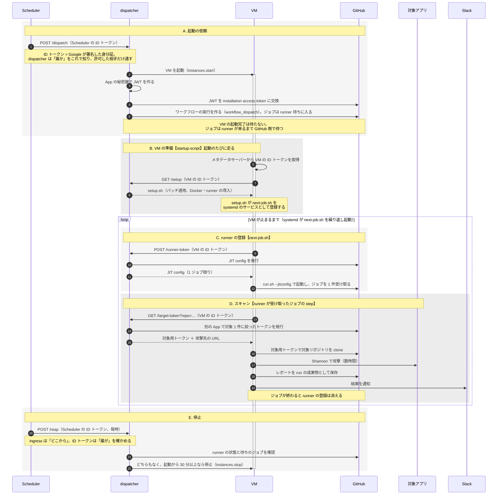
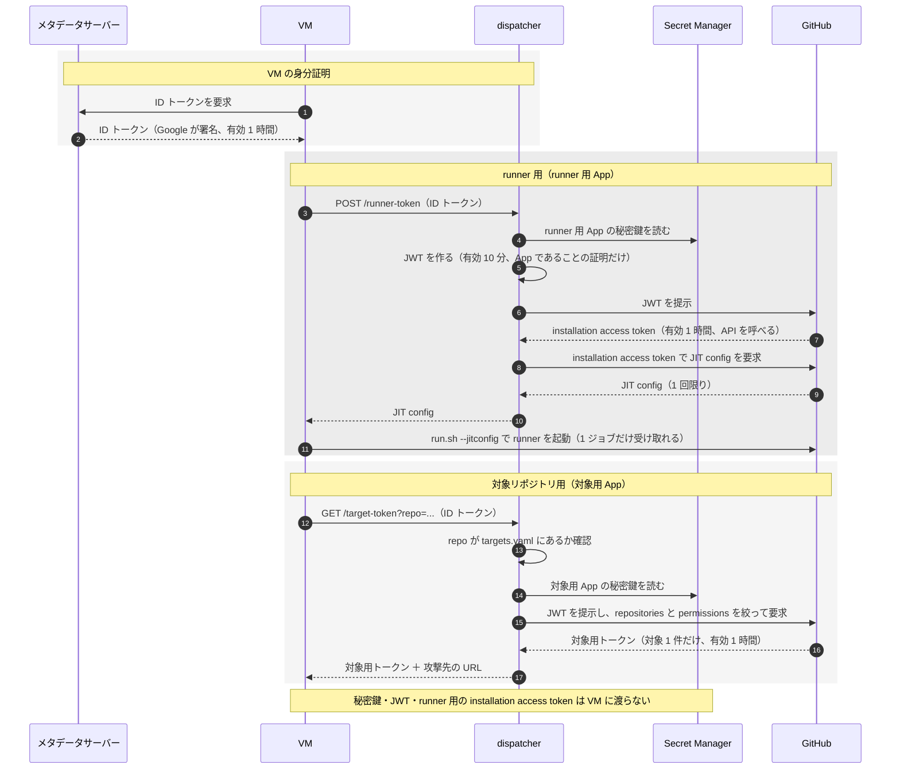

## 概要

OSS の AI ペンテスター [Shannon](https://github.com/KeygraphHQ/shannon) を、検証環境に対して定期実行する基盤を Google Cloud 上に作りました。設計から実装まで一人で担当し、Go・Terraform・GitHub Actions で構築しています。

当初は Cloud Run Jobs で作るつもりでした。ただ、Shannon は実行中に自分でコンテナを立てるため、特権コンテナが必要です。Cloud Run はこれに対応していません。

最終的に、GCE VM 1 台を起動・停止するだけの構成にし、その VM を GitHub Actions の self-hosted runner として使っています。ジョブのキュー管理は GitHub に任せているので、キューの仕組みを自作せずに済みました。

## 背景

ペネトレーションテスト（実際に攻撃して穴を探す診断）は、「年 1 回、外部に依頼する」のが一般的です。その間にも、コードは何百回も変わります。

AI によって攻撃する側が速く・安くなっているなら、守る側も継続的に確かめる必要があると考えました。

そこで、CTEM（Continuous Threat Exposure Management）の考え方を取り入れることにしました。CTEM は、脅威にさらされている状態を継続的に管理するためのプログラムで、5 つのフェーズからなります。全部を一度に整備するのは重いので、まずは「攻撃が本当に通るかを確かめる」Validation フェーズだけに絞りました。

ツールには Shannon を選びました。ソースコードを読んで攻撃経路を探し、実際に攻撃してみて、成功したものだけを報告してくれます。OSS なので費用は LLM の利用料だけです。商用の AI ペンテストは 1 回数千ドル規模のものが多く、桁が違いました。

## 技術選定

### Cloud Run 案が崩れた

「起動して、実行して、終わる」という処理なので、当初は Cloud Run Jobs がぴったりだと考えていました。

ところが、Terraform を書き始める前に Shannon のソースを読んでみると、実行中に自分で `docker run` を呼んでコンテナを立てる作りになっていました。つまり、実行環境の中で Docker を動かすための特権コンテナ（ホストに近い強い権限を持つコンテナ）が必要です。

一方、Cloud Run は公式に [privileged containers に対応していません](https://cloud.google.com/run/docs/container-contract)。この時点で Cloud Run 案は使えないことがわかりました。

### 消去法で VM に

ほかの候補も 1 つずつ外していきました。

| 候補 | 外した理由 |
| -- | -- |
| Cloud Run | 特権コンテナに非対応 |
| GKE Autopilot | 特権 Pod を使うには組織ポリシーの変更が必要 + 会社としてGKEの運用をCloud Runに載せ替えた背景 |
| GKE Standard | ノードは結局 VM なので、運用の手間が減らない + 会社としてGKEの運用をCloud Runに載せ替えた背景 |
| GitHub-hosted runner | 送信元 IP を固定できない（対象の WAF は IP の許可リスト方式） |
| ベンダーの SaaS 版 | ソースコードと攻撃結果が社外を通る |

残ったのは GCE VM でした。

### GitHub Actions で動かす

GitHub Actions を選んだ理由は 2 つです。

- 公式の Action がある：Shannon には公式の GitHub Action（[shannon-action](https://github.com/KeygraphHQ/shannon-action)）がある
- キューを GitHub に任せられる：GitHub は、空いている runner にジョブを 1 件ずつ割り当て、runner が見つからないジョブも[最大 24 時間待ってくれる](https://docs.github.com/en/actions/reference/limits)。Pub/Sub を使っても、メッセージを受け取ってスキャンを走らせるワーカーは自分で書くことになるが、その役を runner が担ってくれる

「GitHub Actions を使う」というと、GitHub のマシンで動くイメージがあるかもしれません。ですが、`runs-on` で自前の VM（self-hosted runner）を指定すれば、実行場所は自分で選べます。

今回は、GitHub のマシン（GitHub-hosted runner）ではなく self-hosted runner を選びました。理由は次の 2 つです。

- 送信元 IP を固定できる：GitHub のマシンは IP が毎回変わるので、対象の前段にある WAF の許可リストに登録できない。自前の VM なら、Cloud NAT の固定 IP から攻撃できる
- 長時間のスキャンに耐えられる：GitHub のマシンでは、1 ジョブは[最大 6 時間](https://docs.github.com/en/actions/reference/limits)まで。スキャンは数時間かかるので余裕がない

### JIT runner で 1 ジョブずつ使い捨てる

self-hosted runner を GitHub に登録する方法は 2 つあり、違いは「誰が登録するか」だけです。

```
registration token 方式: 管理役が registration token（登録専用のトークン）を取る → runner がそれで自分を登録する
JIT config 方式        : 管理役が登録まで済ませる                             → runner は起動するだけ
```

今回は dispatcher が管理役です。GitHub App の秘密鍵で JWT を作り、installation access token に交換し、それで `generate-jitconfig` を叩くと、その時点で登録が済んだ認証情報が返ります。この runner は 1 ジョブだけ受け取れる使い捨ての runner として登録されていて、VM はそれを `run.sh --jitconfig` に渡すだけです。ジョブが終わると登録は消えます。

JIT config を選んだのは、VM に「runner を登録できる鍵」を渡さずに済み、前のジョブの状態も残らないからです。

### ARC の考え方を小さく借りる

この「ジョブが来たら runner を用意し、1 ジョブ終わったら消す」という形は、GitHub 公式の [ARC（Actions Runner Controller）](https://docs.github.com/en/actions/concepts/runners/actions-runner-controller)と同じ考え方です。ARC は Kubernetes 上で、ジョブ数に応じて使い捨ての runner Pod を増減させる仕組みです。

| ARC | 今回 |
| -- | -- |
| listener がジョブを待ち受け、runner の数を決める | dispatcher が VM を起動し、毎時の見回りで止める |
| controller が JIT 設定を取得して runner Pod を作る | dispatcher が JIT 設定を発行し、VM がそれで runner を立てる |
| ジョブが終わると runner Pod を消す | ジョブが終わると runner の登録が消え、作り直す |

ARC そのものを使わなかったのは、Kubernetes が前提だからです。GKE は前述の理由で外していますし、ARC の listener は常時起動しておく必要があります。月 3 回しか動かないので、「0 台か 1 台か」を切り替えるだけで十分でした。複数の対象を並行して回したくなったら、ARC に寄せるのが次の選択肢になります。

## アーキテクチャ

Cloud Run 上に Go で書いた司令塔（dispatcher）を置き、VM の起動・停止、ワークフローの起動、トークンの発行を受け持たせています。VM は外部 IP を持たず、Cloud NAT の固定 IP から攻撃します。

### 1 回のスキャンの流れ



**A. 起動の依頼（1〜5）**：dispatcher は VM を起動したら、起動の完了は待たずにすぐ `workflow_dispatch` でワークフローの実行（workflow run）を作ります。この時点ではジョブは始まらず、GitHub 側で runner が来るまで待ってくれるからです。トリガーを dispatcher の 1 か所に集めたので、「VM の起動」と「ワークフローの起動」の時刻がずれる事故は起きません。

**B. VM の準備（6〜8）**：VM はサービスアカウントキー（秘密鍵の入った JSON ファイル）を持たなくても、メタデータサーバー（`metadata.google.internal`）に HTTP で頼むだけで、Google が署名した ID トークンを受け取れます。メタデータサーバーへのリクエストは [VM が載っている物理ホストの外に出ない](https://cloud.google.com/compute/docs/metadata/overview)ので、身元は鍵ではなく基盤が保証してくれます。startup-script はそれを付けて dispatcher から setup.sh を受け取り、実行するだけです。setup.sh は dispatcher のイメージに埋め込んであるので、main にマージすれば次の起動から反映されます。

**C. runner の登録（9〜12）**：ここからは startup-script ではなく、setup.sh が systemd に登録した `next-job.sh` が動きます。dispatcher に JIT config を頼み、runner を起動します。

**D. スキャン（13〜19）**：ここで動くのは、runner が受け取ったジョブの step です。対象用トークン（種類は installation access token）は、VM が対象リポジトリを clone するためのトークンです。runner 用とは別の GitHub App で発行し、対象リポジトリ 1 件だけに絞っています（有効 1 時間）。dispatcher は、リポジトリ名がレビュー済みの対象一覧（`targets.yaml`）にあるときだけこれを発行し、攻撃先の URL も一緒に返します。ジョブが終わると runner の登録は消え、systemd が C からやり直すので、待っているジョブはまっさらな runner で順番に処理されます。

**E. 停止（20〜22）**：dispatcher が毎時、runner と待ちのジョブを確認し、仕事がなければ VM を止めます。

## 設計で考えたこと

### 攻撃する VM に秘密を置かない

VM は攻撃対象と直接やり取りするので、システムの中でいちばん乗っ取られやすい場所です。

そこで、VM のサービスアカウントには、GitHub App の秘密鍵を読む権限をあえて与えていません。仮に VM が乗っ取られても、Google Cloud の IAM がサーバー側で読み取りを拒否します。

VM と dispatcher の間でやり取りするトークンを並べると、次のようになります。



VM が手にできる GitHub の鍵は、JIT config と対象用トークンだけです。対象用トークンは[発行時に `repositories` と `permissions` を指定](https://docs.github.com/en/rest/apps/apps#create-an-installation-access-token-for-an-app)して「このリポジトリだけ、読み取りと結果の送信だけ」に絞っています。JIT config は 1 ジョブ、対象用トークンは 1 時間で使えなくなります。VM の中に、長く使える GitHub の鍵は残りません。

GitHub App も、用途ごとに 2 つに分けました。App の権限は App ごとに 1 つで、インストール先の Org ごとに変えられません。1 つの App で済ませると、対象側の Org にも、使わない「runner を登録する権限」が付いてしまいます。発行するトークンは絞れても、秘密鍵が漏れたり絞り方を間違えたりすれば、偽の runner で対象 Org のジョブを横取りされかねません。使わない権限は持たせず、攻撃される面を増やさないようにしています。

また、攻撃先の URL はワークフローの入力では受け取らず、レビュー済みの設定ファイルの値を dispatcher が返すようにしています。ワークフローを起動できる人でも、好きな URL を攻撃することはできません。

dispatcher 側の権限も最小限にしています。

- VM を操作できるのは、この VM 1 台だけ
- Secret Manager は、プロジェクト全体ではなく GitHub App の秘密鍵 2 つだけを読める
- VM には専用のサービスアカウントを付け、権限の広いデフォルトのサービスアカウントは使わせない

### dispatcher を呼べる相手を ID トークンで絞る

dispatcher は JIT config や対象用トークンを出す鍵の発行所なので、Scheduler と VM 以外には呼ばせたくありません。

そこで、呼び出しの権限（`roles/run.invoker`）は `allUsers` ではなく、特定のサービスアカウントにだけ与えます。この場合、呼ぶ側は [ID トークンを付けて自分が誰かを示す必要があります](https://cloud.google.com/run/docs/authenticating/service-to-service)。

ID トークンは、メタデータサーバーに頼むだけで受け取れます。API キーのような共有の秘密を VM に置かずに済み、有効期限も約 1 時間です。

ingress: internal とは確かめるものが違います。ingress は「どこから来たか」、ID トークンは「誰が呼んだか」を見るので、両方を重ねています。

### VM は「時刻」ではなく「見回り」で止める

VM の止め方は、2 つの失敗のコストを比べて決めました。

| 失敗 | 損失 |
| -- | -- |
| 止め忘れ | 1 日数ドル |
| スキャンの途中で停止 | 数十ドルの LLM 代と数時間 |

時刻で止める方式だと、実行中のスキャンも止めてしまいます。そこで、毎時 dispatcher が見回り、「動いているジョブも待っているジョブもない」ときだけ止めるようにしました。

1 つハマったのは、JIT の runner がジョブとジョブの間で一瞬いなくなることです。「runner が仕事中か」だけを見ていると、この隙間に止めてしまいます。待っているジョブも仕事として数えることで解決しました。

### 半年ぶりに起動しても動くようにする

VM はたまにしか起動しないので、久しぶりに起動してもそのまま動く必要があります。

そこで、起動のたびに OS のパッチを当て、runner も最新版を入れ直しています。GitHub は古い runner には[ジョブを渡さなくなる](https://docs.github.com/en/actions/hosting-your-own-runners/managing-self-hosted-runners/autoscaling-with-self-hosted-runners#controlling-runner-software-updates-on-self-hosted-runners)ので、バージョンを固定すると半年後には動きません。

### 自動で再試行しない

Cloud Scheduler には、あえて再試行を付けていません。途中まで成功した状態で再試行すると、同じ対象を二重にスキャンしてしまい、数十ドルが無駄になるからです。

たまにしか動かない仕組みなので、失敗したらアラートで気づき、人がやり直すほうが安く済みます。そのため、dispatcher のログは Cloud Logging が読める JSON 形式で出力し、エラーが出たら Slack に通知されるアラートを設定しています。

### 状態を持たないローテーション

LLM の費用を抑えるため、対象のサービスを順番に並べ、月 3 回・1 件ずつスキャンしています。

```
対象 = targets[(経過月数 × 3 + slot) % 件数]   ※ slot は 0, 1, 2（Scheduler 3 本に固定）
```

「前回どこまで進んだか」は保存していません。日付だけで対象が決まるので、データベースが要らず、「来月はこのサービス」と前もって告知することもできます。

## ぶつかった壁

### VM から dispatcher を呼ぶと 404 になった

dispatcher は、VPC の内側からしか呼べない設定（ingress: internal）にしていました。ところが、Shared VPC 上の VM から呼ぶと 404 が返ってきて、アプリにはログすら残りませんでした。

原因は公式ドキュメントに書かれていました。Shared VPC からのリクエストが「内側」と見なされるのは、[Cloud Run 側が Direct VPC egress でその VPC につながっているときだけ](https://cloud.google.com/run/docs/securing/private-networking#shared-vpc)です。

つまり、受信できるかどうかが、送信側の設定で決まるということです。直感に反する仕様でした。dispatcher に Direct VPC egress 用のサブネットを割り当てて解決しました。

### 404 が直ったら、次は 403

拒否した理由をログに出してみると、VM が発行する ID トークンに `email` が入っていませんでした。dispatcher は呼び出し元をメールアドレスで確認していたので、すべて弾いていたのです。

[公式ドキュメント](https://cloud.google.com/compute/docs/instances/verifying-instance-identity)によると、既定の形式（`format=standard`）のトークンには `email` が含まれません。サービスアカウントの一意な ID である `sub` で確認するように変えて解決しました。

## まとめ

- Shannon が特権コンテナを必要とするため、Cloud Run ではなく GCE VM 1 台を起動・停止する構成にした。どこで動かすかを決める前に、ツールが何を必要とするかをソースで確かめるのが大事だった
- GitHub Actions を「キュー付きのジョブ実行基盤」として使い、キューの仕組みを自作せずに済ませた
- いちばん危ない VM には、使い捨ての弱いトークンだけを渡す。強い権限は dispatcher に閉じ込めた
- VM の止め方や再試行の有無は、失敗したときのコストを比べて決めた
- インフラはすべて Terraform で管理し、PR は「起動 → 準備 → 登録 → スキャン → 停止」の段階ごとに分けてレビューしやすくした

## 参考

- Shannon: https://github.com/KeygraphHQ/shannon
- Cloud Run のコンテナランタイム契約: https://cloud.google.com/run/docs/container-contract
- Cloud Run と Shared VPC: https://cloud.google.com/run/docs/securing/private-networking#shared-vpc
- GCE の ID トークン: https://cloud.google.com/compute/docs/instances/verifying-instance-identity
- Cloud Run のサービス間認証: https://cloud.google.com/run/docs/authenticating/service-to-service
- GitHub Actions の JIT runner: https://docs.github.com/en/rest/actions/self-hosted-runners#create-configuration-for-a-just-in-time-runner-for-an-organization
- GitHub Actions の制限: https://docs.github.com/en/actions/reference/limits
- Actions Runner Controller: https://docs.github.com/en/actions/concepts/runners/actions-runner-controller
